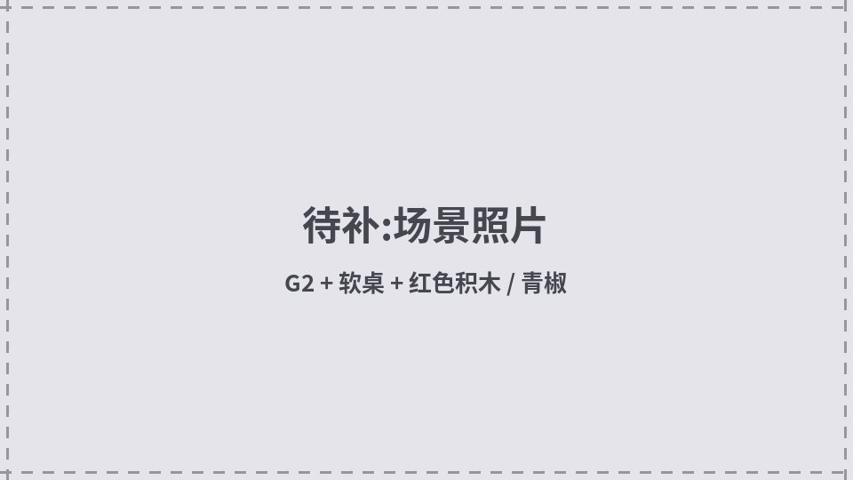
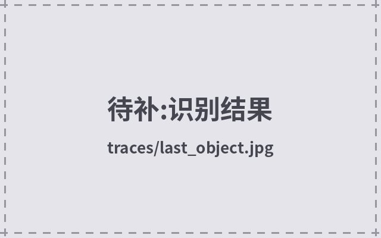
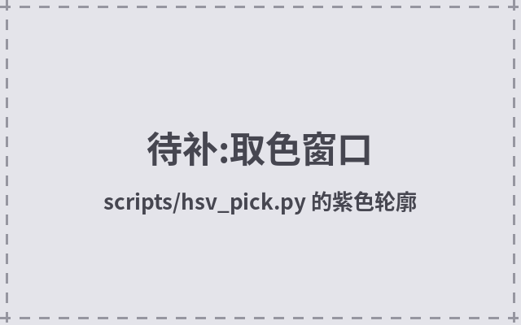
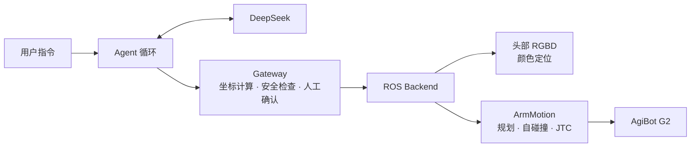
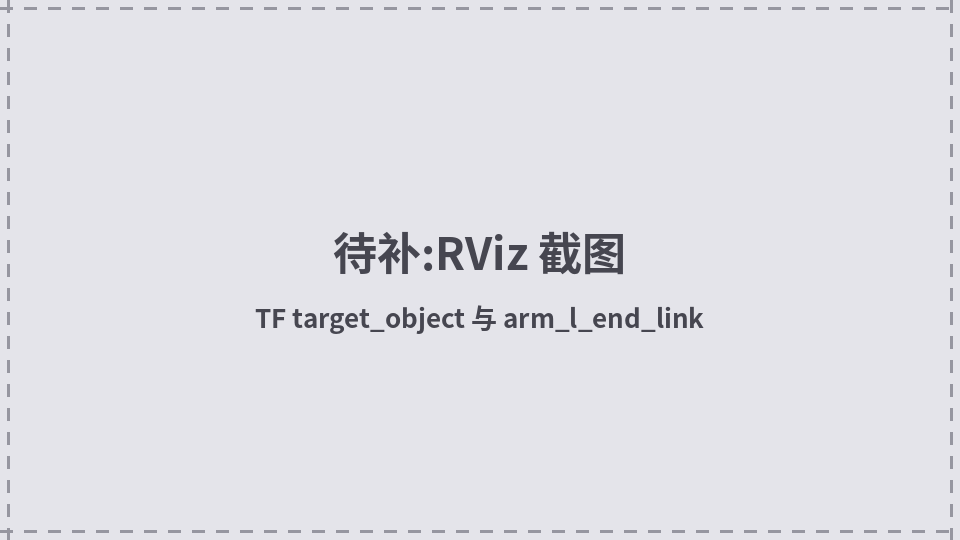

# G2 Robot Harness


用自然语言指挥智元 G2 人形机器人。大模型负责理解指令、选择技能;视觉定位、运动规划和安全检查全部由程序完成,模型无法直接控制关节或坐标。

<p align="center">
  
</p>

<p align="center">
  
  
</p>

## 功能

- **自然语言指令**:如“左手抵达绿色青椒上空”,模型自行决定调用哪些工具、按什么顺序。
- **按颜色定位物体**:头部 RGBD 相机 + HSV 分割 + 多帧融合,输出 `base_link` 下的坐标,并发布 TF `target_object`。
- **任意颜色可扩展**:预置红、橙、黄、绿、蓝、紫;特殊颜色在画面上点选即可加入,无需改代码。
- **同色多物体**:默认选择离左臂末端最近的一个。
- **复用现有运控**:调用 `agi@g2_robot` 的积分笛卡尔规划,构型连续、带整机自碰撞检查。
- **可追溯**:每条指令的模型回复、工具调用和结果都写入 `traces/`。

<p align="center">
  
  
</p>

## 工作原理



模型只能看到三个工具:

| 工具 | 作用 | 是否运动 |
|---|---|---|
| `locate_object(color)` | 按颜色定位物体 | 否 |
| `get_left_end_pose()` | 读取 `arm_l_end_link` 位置 | 否 |
| `approach_object(standoff_cm)` | 左臂末端直线移到物体正上方 | 是 |

`approach_object` 没有坐标参数,目标点由 Gateway 根据最近一次定位结果计算。

<p align="center">
  
</p>

## 安全设计

| 机制 | 说明 |
|---|---|
| 人工确认 | 真机每次运动前打印目标和规划,输入 `y` 才执行 |
| 只规划模式 | `--plan-only` 完整走一遍流程,绝不发送运动 |
| 悬停距离 | 末端停在物体上方 18~40cm,默认 25cm,工具不会接触物体 |
| 范围限制 | 工作空间、单次移动距离、末端速度均有上限 |
| 防穿桌 | 末端起点必须比物体高 13cm 以上 |
| 定位时效 | 定位结果 30s 后作废,定位失败会清除旧目标 |
| 次数限制 | 每条指令最多运动一次 |

当前版本只检查机器人自碰撞,不包含环境避障,运行时需有人值守急停。

## 目录结构

```text
robot_harness/
├── harness/               核心代码
│   ├── loop.py            Agent 循环:问模型 → 执行工具 → 返回结果
│   ├── llm.py             DeepSeek 接口(标准库 HTTP)
│   ├── gateway.py         模型与机器人之间的关卡:坐标计算与安全检查
│   ├── colors.py          颜色表读写、由采样像素计算 HSV 范围
│   ├── tools/             给模型看的工具定义
│   └── backends/          执行层
│       ├── ros.py         真机:相机、TF、ArmMotion
│       ├── fake.py        假机器人,用于测试
│       └── color_object.py  HSV 分割与多帧融合
├── configs/               模型、运动、视觉参数与颜色表
├── scripts/               入口:run_task.py 运行指令,hsv_pick.py 点选取色
├── tests/                 离线测试,不需要模型和 ROS
├── traces/                运行记录与最近一次识别画面
├── scenarios/             模型评测用例(规划中)
├── fixtures/              真机录制的测试数据(规划中)
├── reforence/             参考资料
├── docs/
│   ├── harness_guide.md   一篇读懂全部代码,含动手练习
│   └── media/             README 图片
├── run.txt                常用命令
└── devlog.md              开发日志
```

每个文件夹都有自己的 `README.md`,说明其中文件的作用和联动关系。

## 环境

- Ubuntu 22.04 · ROS 2 Humble · Python 3.10
- 已编译的 `agi@g2_robot` 工作空间(MoveIt 配置、`genie_robot_agibot_g2_motion`、`task_board_pose`)
- DeepSeek API key,填写在项目根目录的 `.env`

启动与使用命令见 [`run.txt`](run.txt),开发过程见 [`devlog.md`](devlog.md),代码导读见 [`docs/harness_guide.md`](docs/harness_guide.md)。

## 已知限制

- 只控制左臂,只移动到物体上方,不包含抓取。
- 没有环境避障,桌面等障碍物不在碰撞检查中。
- 颜色定位依赖光照;同色物体距离手臂相近时会拒绝执行。
- 可达范围受腰部姿态影响,目标过远时规划会失败。
