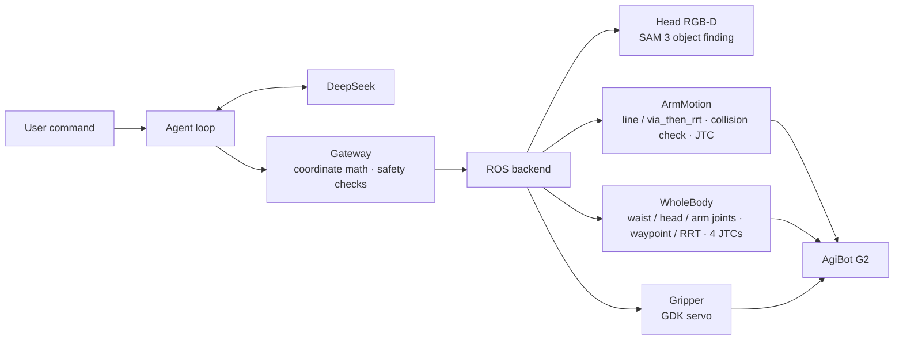

# G2 Robot Harness

**English** | [中文](README.zh-CN.md)


Control an AgiBot G2 humanoid robot with natural language. An LLM interprets the command and chooses which skills to call. Object detection, motion planning and safety checks are done by ordinary code, so the model never outputs joint angles or absolute coordinates.

<!-- TODO: docs/media/demo.gif (see docs/media/SHOT_LIST.md, item 1)
<p align="center">
  
</p>
-->

## Highlights

- **Natural-language tasks.** For a command like *"look down, find the mouse and pick it up"*, the model decides which tools to call and in what order.
- **Open-vocabulary object finding.** Head RGB-D camera plus a local SAM 3 service. Objects are segmented by name, located in `base_link`, and given handles such as `mouse_1` or `phone_2`. Later tools refer to objects by handle only.
- **Collision-aware arm planning.** The planner tries a Cartesian straight line first, then a `via_then_rrt` detour. If the target is out of reach, the robot leans or turns its waist and plans again. Every path is checked against whole-body self-collision and the octomap point cloud.
- **A fixed two-stage chain for contact.** `touch_object` plans a fully collision-checked path to a pre-contact point it has already verified. Only the last few centimetres move slowly, and there only the point-cloud cells around the target object are ignored; the table, other objects and self-collision are still checked. If the requested direction is out of reach, the robot leans first rather than switching to a sideways push. See [docs/touch_chain.md](docs/touch_chain.md) (in Chinese).
- **Joint-space motion** for waist, head and both arms. If a direct move would collide, it goes through a recorded waypoint pose or a joint-space RRT.
- **Gripper control** for the right-hand gripper, through the robot's GDK servo interface.
- **Traceable runs.** Every model reply, tool call and result is logged to `traces/`.

## How it works



Tools exposed to the model:

| Tool | What it does | Moves the robot |
|---|---|---|
| `get_robot_state()` | Read waist, head and arm joints and both end-effector poses | No |
| `find_objects(query)` | Segment objects by English name with SAM 3; handles are numbered by distance | No |
| `look_at_object(object_id)` | Turn the head to center the object | Yes |
| `approach_object(object_id, standoff_cm, arm)` | Move the gripper tip above the object | Yes |
| `point_at_object(object_id, arm)` | Point the gripper at the object (rotation only) | Yes |
| `touch_object(object_id, arm)` | Bring the gripper tip into contact (high-five, fist bump, reach down to a surface) | Yes |
| `move_arm_end(arm, offset_cm, rotate_deg)` | Relative translation / rotation of the end effector | Yes |
| `move_joints(group, deltas_deg / angles_deg)` | Rotate waist / head / left arm / right arm joints | Yes |
| `go_to_pose(name, groups)` | Go to a recorded whole-body pose from `configs/poses.yaml` | Yes |
| `gripper(arm, action)` | Open / close the gripper | Yes |
| `take_photo(camera)` | Save a head-camera photo to `photos/` | No |
| `wait(seconds)` | Pause between steps | No |

The model cannot send absolute coordinates. Targets for `approach_object` and `touch_object` are computed by the Gateway from the object handle, and `move_arm_end` only accepts relative offsets. On the real robot, a motion runs automatically once planning succeeds. Pass `--confirm` to require pressing `y` before each motion.

<!-- TODO: docs/media/sam3.png and docs/media/terminal.gif (see docs/media/SHOT_LIST.md, items 2 and 3)
<p align="center">
  
  
</p>
-->

## Safety

| Mechanism | Details |
|---|---|
| Plan printout | Every real motion prints its target and plan first. Set `confirm_motion: true` or pass `--confirm` to require `y` |
| Plan-only mode | `--plan-only` runs the whole pipeline but never sends a motion |
| Only `touch_object` may make contact | All other arm motions are fully checked against the point cloud and fail honestly. `touch_object` ignores only the cloud cells around the target object, and only in the final segment (≤ 30 cm, 0.03 m/s) |
| Standoff | `approach_object` stops 3–30 cm above the object (default 12 cm), and the whole path must stay above it |
| Limits | Workspace box, per-move travel distance and end-effector speed are capped |
| Detection expiry | `find_objects` results expire after 120 s |
| Motion budget | At most 8 motions per command, gripper actions included |

Collision checking only knows about what MoveIt knows about. Always keep someone at the emergency stop.

## Quick start

```bash
source /opt/ros/humble/setup.bash
cd robot_harness

# Offline tests (fake robot; ROS-dependent tests are skipped if ROS is missing)
python3 -m pytest tests -q

# Fake robot, no hardware (its fake scene contains two phones)
python3 scripts/run_task.py "find the phone and touch it"

# Real robot, plan only (requires hardware.launch.py and the SAM 3 service)
python3 scripts/run_task.py --real --plan-only "低头找鼠标,拿起来"
```

Put your DeepSeek API key in `.env` at the repository root as `DEEPSEEK_API_KEY=...`. All runnable commands are in [`run.txt`](run.txt) and [`devlog.md`](devlog.md).

## Repository layout

```text
robot_harness/
├── harness/               core code
│   ├── loop.py            agent loop: ask model → run tools → return results
│   ├── llm.py             DeepSeek client (standard-library HTTP)
│   ├── gateway.py         checkpoint between model and robot: coordinates and safety
│   ├── tools/             tool schemas shown to the model
│   ├── backends/          execution layer
│   │   ├── ros.py         real robot: planning chains (plan_arm_to / plan_touch), execution
│   │   ├── fake.py        fake robot for tests
│   │   └── gripper_gdk.py gripper (GDK)
│   ├── motion/            motion control and planning (ArmMotion, via_then_rrt, WholeBody)
│   └── perception/        head RGB-D, SAM 3 client, head aiming
├── configs/               model, motion and vision parameters; recorded poses
├── scripts/               entry points: run_task.py, goto_pose.py, sam3_live.py, ...
├── tests/                 offline tests: harness logic (no ROS), motion and touch chain (ROS)
├── learning/              step-by-step exercises (LLM calls → ROS)
├── docs/                  design notes, indexed in docs/index.md
├── run.txt                common commands
└── devlog.md              development log
```

Every folder has its own `README.md`. Design notes, the devlog and code comments are written in Chinese.

## Requirements

- Ubuntu 22.04 · ROS 2 Humble · Python 3.10
- ROS packages: `rclpy`, `tf2_ros`, `urdf_parser_py`, `python3-pykdl`, plus `moveit_msgs`, `control_msgs` and other message packages
- Python packages: `numpy`, `scipy`, `opencv-python`, `PyYAML`
- External processes: `hardware.launch.py` from `agi@g2_robot` (ros2_control + JTC + MoveIt `move_group` + point cloud) and a local SAM 3 service ([docs/sam3_service.md](docs/sam3_service.md))
- A DeepSeek API key

## Known limitations

- Grasping is still basic. The gripper points down, descends to the object's top surface and closes, which only works for blocks and similar objects. Shape-aware grasp poses (bottles, mugs with handles) are planned.
- Only the right hand has a gripper.
- Collision checking covers the robot itself, the octomap, and collision objects added to the planning scene. When launched with `use_head_cloud:=false` there is no octomap, so the table is not in the collision check.
- Reach depends on waist posture, so planning to far targets can fail.
- Parts of `harness/motion/` and `harness/perception/` are copied from `agi@g2_robot` and must be synced by hand.
