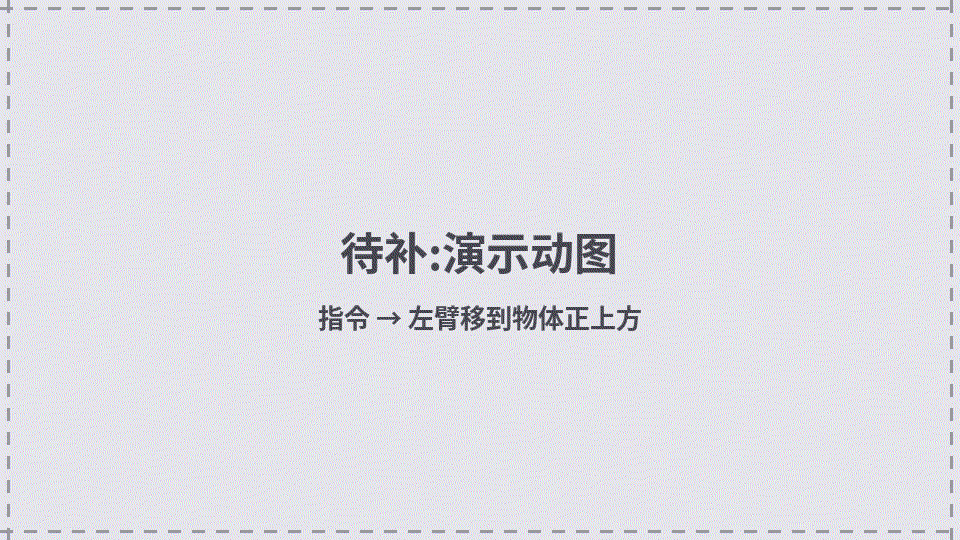
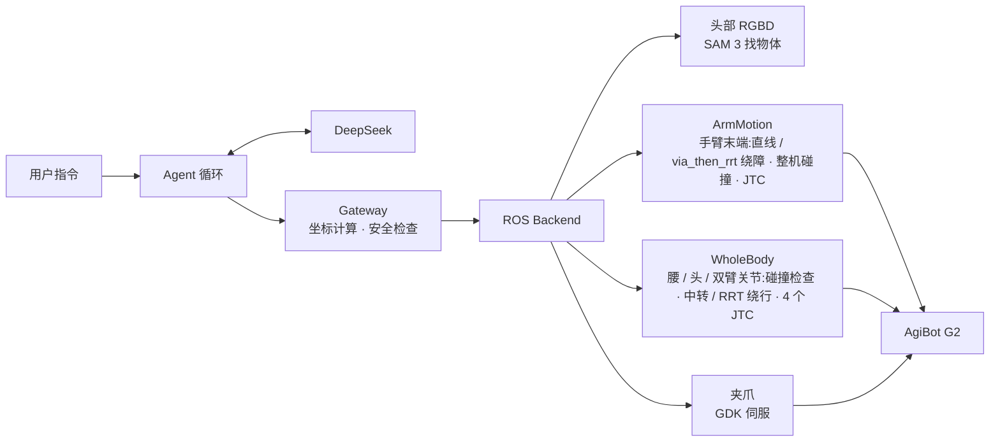

# G2 Robot Harness

[English](README.md) | **中文**


用自然语言指挥智元 G2 人形机器人。大模型负责理解指令、选择技能；找物体、运动规划和安全检查全部由程序完成，模型无法直接给出关节角或绝对坐标。

<!-- 待拍:docs/media/demo.gif(拍摄要求见 docs/media/SHOT_LIST.md 第 1 条)
<p align="center">
  
</p>
-->

## 功能

- **自然语言指令**：例如“低头找鼠标，拿起来”，模型自己决定调用哪些工具、按什么顺序。
- **按名字找物体**：头部 RGBD 相机 + 本机 SAM 3 服务，按英文名分割，输出 `base_link` 下的坐标，并编号（`mouse_1`、`phone_2`），后续工具都用编号。
- **手臂规划先直线，再绕障**：积分笛卡尔直线，走不通就改用 `via_then_rrt` 绕障；够不着时先前倾、转腰再规划。全程查整机自碰撞和 octomap 点云。
- **碰触有固定的两段链路**：`touch_object` 先查着碰撞走到验过的预接触点，只有最后几厘米慢速、只放过物体附近的点云（桌面和自碰撞照查），见 [docs/touch_chain.md](docs/touch_chain.md)。
- **关节组运动**：腰、头、双臂按关节角运动，会撞时经录好的位姿中转或走关节 RRT。
- **夹爪**：右手夹爪走 GDK 伺服接口。
- **可追溯**：每条指令的模型回复、工具调用和结果都写入 `traces/`。

## 工作原理



模型能看到的工具：

| 工具 | 作用 | 是否运动 |
|---|---|---|
| `get_robot_state()` | 读取腰、头、双臂关节角和两臂末端位姿 | 否 |
| `find_objects(query)` | SAM 3 按英文物体名找，按距离编号 | 否 |
| `look_at_object(object_id)` | 转头让该物体在画面中央 | 是 |
| `approach_object(object_id, standoff_cm, arm)` | 夹爪尖移到物体正上方 | 是 |
| `point_at_object(object_id, arm)` | 夹爪指向该物体（末端不动，只转方向） | 是 |
| `touch_object(object_id, arm)` | 夹爪尖碰到该物体（击掌、碰拳、下探到物体表面） | 是 |
| `move_arm_end(arm, offset_cm, rotate_deg)` | 手臂末端相对平移 / 转动 | 是 |
| `move_joints(group, deltas_deg / angles_deg)` | 腰 / 头 / 左臂 / 右臂关节转动 | 是 |
| `go_to_pose(name, groups)` | 回到 `configs/poses.yaml` 里录好的位姿 | 是 |
| `gripper(arm, action)` | 打开 / 闭合夹爪 | 是 |
| `take_photo(camera)` | 头部相机拍照存到 `photos/` | 否 |
| `wait(seconds)` | 两步之间等几秒 | 否 |

模型给不了绝对坐标：`approach_object`、`touch_object` 的目标点由 Gateway 根据物体编号计算，`move_arm_end` 只收相对偏移。真机运动默认规划通过后自动执行（`--confirm` 恢复逐次按 `y`）。

<!-- 待拍:docs/media/sam3.png 和 docs/media/terminal.gif(拍摄要求见 docs/media/SHOT_LIST.md 第 2、3 条)
<p align="center">
  
  
</p>
-->

## 安全设计

| 机制 | 说明 |
|---|---|
| 打印计划 | 真机每次运动前打印目标和规划，默认直接执行；`confirm_motion: true` 或 `--confirm` 时输入 `y` 才执行 |
| 只规划模式 | `--plan-only` 完整走一遍流程，绝不发送运动 |
| 只有 touch 能碰物体 | 其余手臂运动全程查点云碰撞，规划失败就如实报告；`touch_object` 只有最后几厘米（≤30 cm，0.03 m/s）放过物体附近的点云，桌面照查 |
| 悬停距离 | `approach_object` 夹爪尖停在物体上方 3~30 cm，默认 12 cm；整条路径都要比物体高 |
| 范围限制 | 工作空间、单次移动距离、末端速度均有上限 |
| 物体时效 | `find_objects` 的结果 120 s 后作废 |
| 次数限制 | 每条指令最多运动 8 次（夹爪开合也算） |

碰撞检查只认识 MoveIt 里有的东西，运行时必须有人值守急停。

## 目录结构

```text
robot_harness/
├── harness/               核心代码
│   ├── loop.py            Agent 循环:问模型 → 执行工具 → 返回结果
│   ├── llm.py             DeepSeek 接口(标准库 HTTP)
│   ├── gateway.py         模型与机器人之间的关卡:坐标计算与安全检查
│   ├── tools/             给模型看的工具定义
│   ├── backends/          执行层
│   │   ├── ros.py         真机:规划链路(plan_arm_to / plan_touch)、执行
│   │   ├── fake.py        假机器人,用于测试
│   │   └── gripper_gdk.py 夹爪(GDK)
│   ├── motion/            运控与绕障规划(ArmMotion、via_then_rrt、WholeBody)
│   └── perception/        头部 RGBD、SAM 3 客户端、转头对准
├── configs/               模型、运动、视觉参数,录好的全身位姿
├── scripts/               入口:run_task.py 运行指令,goto_pose.py 全身位姿,sam3_live.py 实时分割
├── tests/                 离线测试:harness 逻辑(不需要 ROS)、运控与 touch 链路(需要 ROS)
├── learning/              从零学起的练习(大模型调用 → ROS)
├── docs/                  设计文档,目录见 docs/index.md
├── run.txt                常用命令
└── devlog.md              开发日志
```

每个文件夹都有自己的 `README.md`，说明其中文件的作用和联动关系。

## 环境

- Ubuntu 22.04 · ROS 2 Humble · Python 3.10
- ROS 包：`rclpy`、`tf2_ros`、`urdf_parser_py`、`python3-pykdl`，以及 `moveit_msgs`、`control_msgs` 等消息
- Python 包：`numpy`、`scipy`、`opencv-python`、`PyYAML`
- 外部进程：`agi@g2_robot` 的 `hardware.launch.py`（ros2_control + JTC + MoveIt `move_group` + 点云），本机 SAM 3 服务（[docs/sam3_service.md](docs/sam3_service.md)）
- DeepSeek API key，填写在项目根目录的 `.env`

启动与使用命令见 [`run.txt`](run.txt)，开发过程见 [`devlog.md`](devlog.md)，代码导读见 [`docs/harness_guide.md`](docs/harness_guide.md)，其他设计文档见 [`docs/index.md`](docs/index.md)。

## 已知限制

- 抓取还很初级：夹爪朝下、下探到物体上表面再闭合，只适合积木这类从上往下夹哪里都行的物体。按形状算抓取位姿还在规划中。
- 只有右手装了夹爪。
- 碰撞检查只认识 MoveIt 里有的东西：机器人自身、octomap、planning scene 里加的碰撞体。用 `use_head_cloud:=false` 启动时没有 octomap，桌面不在碰撞检查里。
- 可达范围受腰部姿态影响，目标过远时规划会失败。
- `harness/motion/` 与 `harness/perception/` 的部分代码是 `agi@g2_robot` 的副本，原项目更新后需要手动同步。
