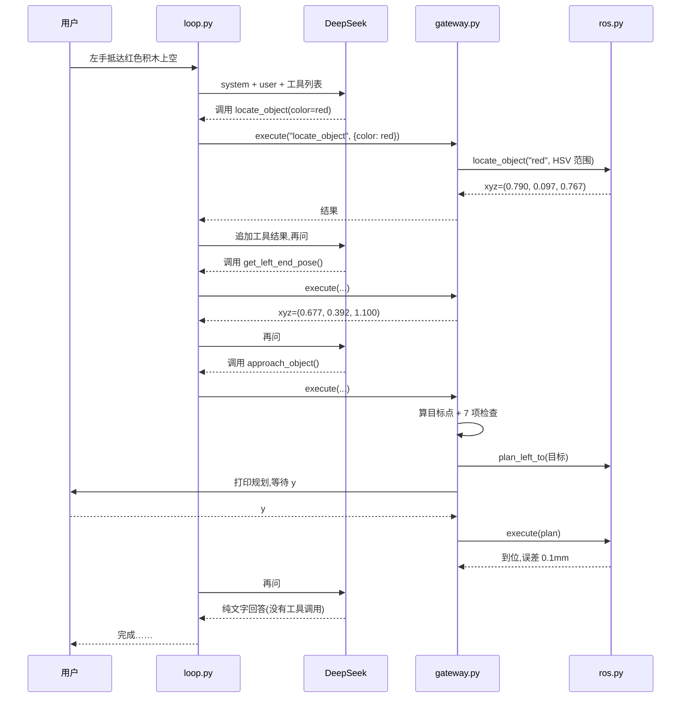

# 一篇读懂 G2 Robot Harness

这篇文档从零讲清楚这个项目:harness 是什么、一条指令在代码里怎么走、每个文件做什么、为什么这么写。最后一章带你亲手写下一个工具。

> 行号以 2026-11-09 的版本为准。`harness/motion/` 和 `harness/perception/` 是从 `agi@g2_robot` 复制来的代码,本文只讲 harness 用到的部分。链接格式 `文件#L行号`,在 VS Code 的 Markdown 预览和 GitHub 上点击即可跳转。改过代码后行号可能偏移,按函数名找即可。

## 目录

1. [Harness 是什么](#1-harness-是什么)
2. [一条指令的完整旅程](#2-一条指令的完整旅程)
3. [文件地图](#3-文件地图)
4. [入口:run_task.py](#4-入口run_taskpy)
5. [循环:loop.py](#5-循环looppy)
6. [模型接口:llm.py](#6-模型接口llmpy)
7. [工具说明书:tools/objects.py](#7-工具说明书toolsobjectspy)
8. [关卡:gateway.py](#8-关卡gatewaypy)
9. [执行层:backends/](#9-执行层backends)
10. [颜色视觉:color_object.py 与 colors.py](#10-颜色视觉color_objectpy-与-colorspy)
11. [取色工具:hsv_pick.py](#11-取色工具hsv_pickpy)
12. [配置:configs/](#12-配置configs)
13. [测试:tests/](#13-测试tests)
14. [坐标系](#14-坐标系)
15. [安全设计总表](#15-安全设计总表)
16. [排错指南](#16-排错指南)
17. [动手:手搓抬手工具 lift_left_end](#17-动手手搓抬手工具-lift_left_end)

---

## 1. Harness 是什么

大模型只会做一件事:**读一段文字,输出一段文字**。它没有手,不能读相机,也不能发 ROS 消息。

Harness 是包在模型外面的那层程序,负责四件事:

| 职责 | 本项目里的实现 |
|---|---|
| 告诉模型能做什么 | [harness/tools/objects.py](../harness/tools/objects.py):三个工具的名字、说明和参数 |
| 把模型的话变成动作 | [harness/loop.py](../harness/loop.py) 解析模型回复,[harness/gateway.py](../harness/gateway.py) 执行 |
| 拦住危险动作 | [harness/gateway.py](../harness/gateway.py) 里的检查,加上人工按 `y` |
| 把结果告诉模型 | [harness/loop.py](../harness/loop.py) 把工具结果追加进对话 |

一个类比:模型像只会打电话的指挥员,harness 是接电话的值班员。指挥员说“去定位红色积木”,值班员查规定、执行、回报结果。指挥员永远碰不到机器,值班员也绝不执行规定之外的事。

这个项目最重要的设计原则:**模型只决定“下一步调用哪个工具”,所有坐标和运动都由程序计算**。模型没有任何途径直接给出关节角或 xyz。

---

## 2. 一条指令的完整旅程

下面是一条真实的运行记录(`traces/20261109_015006.jsonl`,2026-11-09 真机),指令是“左手抵达红色积木上空”。



逐步对应到代码:

**第 1 轮**:模型收到指令和工具列表,回复要调用 `locate_object`。这段 JSON 是 DeepSeek 真实返回的格式:

```json
{"role": "assistant", "content": "红砖积木,先定位。",
 "tool_calls": [{"index": 0, "id": "call_00_7AmM2Z6UuANBJHy5ykm61551", "type": "function",
                 "function": {"name": "locate_object", "arguments": "{\"color\": \"red\"}"}}]}
```

注意 `arguments` 是**字符串**,里面才是 JSON,所以要 `json.loads` 一次,见 [harness/loop.py#L45](../harness/loop.py#L45)。

**程序执行**:[gateway.py#L32](../harness/gateway.py#L32) 的 `_locate` 查颜色表,调用 [ros.py#L83](../harness/backends/ros.py#L83) 的 `locate_object`,头部相机取 5 帧,得到:

```json
{"ok": true, "frame": "base_link", "tf": "target_object", "color": "red",
 "xyz_m": [0.7901, 0.0968, 0.7674], "pixels": 74, "depth_m": 0.773, "size_m": 0.03,
 "candidates": 2, "selected": "离左臂末端最近", "distance_to_left_end_m": 0.459}
```

`candidates: 2` 表示画面里看到两个红色物体,程序选了离左臂最近的那个。

**第 2 轮**:模型调用 `get_left_end_pose`,得到末端在 (0.677, 0.392, 1.100)。

**第 3 轮**:模型调用 `approach_object`,参数为空 `{}`,用默认悬停 25cm。Gateway 算出目标点 = 积木 + (0, 0, 0.25) = (0.790, 0.097, 1.017),通过全部检查后规划、等你按 `y`、执行,返回:

```json
{"ok": true, "executed": true, "msg": "JTC 成功(8.9s);实测已停稳在终点",
 "end_xyz_m": [0.79, 0.0968, 1.0174], "error_to_target_mm": 0.1, "distance_to_object_m": 0.25,
 "target_xyz_m": [0.7901, 0.0968, 1.0174], "standoff_m": 0.25, "travel_m": 0.326,
 "plan": "积分笛卡尔直线 32.6cm:57 个轨迹点,8.5s,……"}
```

**第 4 轮**:模型看到 `executed: true`,不再调用工具,用文字总结。循环在 [loop.py#L27-L28](../harness/loop.py#L27-L28) 结束。

有时模型会**在一轮里同时调用两个工具**(比如一起调 `locate_object` 和 `get_left_end_pose`),这是正常的,[loop.py#L30](../harness/loop.py#L30) 的 `for` 循环会依次执行。

---

## 3. 文件地图

| 文件 | 一句话 | 依赖谁 | 被谁用 |
|---|---|---|---|
| [scripts/run_task.py](../scripts/run_task.py) | 入口:读配置、组装、启动 | 下面所有 | 你 |
| [harness/loop.py](../harness/loop.py) | Agent 循环 | 无(只接收 llm 和 gateway 对象) | run_task、测试 |
| [harness/llm.py](../harness/llm.py) | 调 DeepSeek | 标准库 | run_task |
| [harness/tools/objects.py](../harness/tools/objects.py) | 给模型看的工具定义 | 无 | run_task、测试 |
| [harness/gateway.py](../harness/gateway.py) | 坐标计算与安全检查 | backend 对象 | run_task、测试 |
| [harness/backends/ros.py](../harness/backends/ros.py) | 真机执行 | motion、perception、ROS | run_task(`--real`) |
| [harness/motion/](../harness/motion/README.md) | 运控:直线规划、`via_then_rrt` 绕障、全身位姿 | ROS、PyKDL | ros.py、goto_pose、motion_cli |
| [harness/perception/](../harness/perception/README.md) | 头部 RGBD 取帧、深度转 3D | ROS、OpenCV | ros.py、hsv_pick |
| [harness/backends/fake.py](../harness/backends/fake.py) | 假机器人 | 无 | run_task、测试 |
| [harness/backends/color_object.py](../harness/backends/color_object.py) | HSV 分割、多帧融合 | OpenCV、numpy | ros.py、hsv_pick、测试 |
| [harness/colors.py](../harness/colors.py) | 颜色表读写、采样算范围 | PyYAML、numpy | run_task、hsv_pick、测试 |
| [scripts/hsv_pick.py](../scripts/hsv_pick.py) | 点选取色 | colors、color_object、perception | 你 |
| [scripts/goto_pose.py](../scripts/goto_pose.py) | 全身移到录好的位姿 | motion | 你 |
| [scripts/motion_cli.py](../scripts/motion_cli.py) | 手臂交互命令行 | motion | 你 |
| [configs/harness.yaml](../configs/harness.yaml) | 模型、运动、视觉参数 | — | run_task、测试 |
| [configs/colors.yaml](../configs/colors.yaml) | 颜色表 | — | run_task、hsv_pick |
| [configs/poses.yaml](../configs/poses.yaml) | 录好的全身位姿 | — | goto_pose |
| [tests/test_objects.py](../tests/test_objects.py) | 离线测试,不需要 ROS | 上面的纯 Python 部分 | pytest |
| [tests/test_motion.py](../tests/test_motion.py) | 运控与绕障测试,需要 ROS | motion | pytest |
| `.env` | DeepSeek key,不提交 | — | run_task |
| `traces/` | 运行记录和识别画面 | — | 你排错时看 |

依赖方向只有一个:**入口 → 循环 → 关卡 → 执行层 → 运控 / 相机**。运行时唯一的外部进程是 `hardware.launch.py`(JTC + MoveIt)。`loop.py` 不知道机器人存在,`gateway.py` 不知道模型存在,所以每一层都能单独测试。

---

## 4. 入口:run_task.py

入口只做组装,不放业务逻辑。

### 4.1 读 key

[scripts/run_task.py#L26-L36](../scripts/run_task.py#L26-L36)

```python
def load_env(path):
    """读取 .env;里面填了值的项优先于终端的环境变量。"""
    if not path.exists():
        return
    for line in path.read_text(encoding="utf-8").splitlines():
        line = line.strip()
        if line and not line.startswith("#") and "=" in line:
            key, value = line.split("=", 1)
            value = value.strip().strip("'\"")
            if value:
                os.environ[key.strip()] = value
```

- `.env` 里填了值才覆盖环境变量,空值不覆盖。这样终端里残留的错误 key(比如曾经 export 的“你的key”)不会生效。
- 只是简单的 `KEY=VALUE` 解析,不需要装 `python-dotenv`。

### 4.2 每条指令的组装

[scripts/run_task.py#L43-L50](../scripts/run_task.py#L43-L50)

```python
def run_one(task, llm, backend, cfg, args):
    colors = load_colors(ROOT / "configs/colors.yaml")      # 每条指令重读,取色后不用重启
    gateway = Gateway(backend, cfg["motion"], colors, confirm=ask_user if args.real else None,
                      plan_only=args.plan_only)
    trace_path = ROOT / "traces" / f"{time.strftime('%Y%m%d_%H%M%S')}.jsonl"
    with open(trace_path, "w", encoding="utf-8") as trace:
        answer = run_agent(task, llm, gateway, make_tools(colors), max_steps=cfg["agent"]["max_steps"], trace=trace)
    print(f"\n机器人助手:{answer}\n[trace] {trace_path}\n", flush=True)
```

三个要点:

1. **每条指令新建一个 Gateway**。Gateway 里记着“定位到的目标”和“已经动了几次”,新指令必须从干净状态开始,否则上一条指令的目标可能被沿用。
2. **颜色表每条指令重读**。用 `hsv_pick.py` 加了新颜色,交互模式下不用重启。
3. `confirm=ask_user if args.real else None`:只有真机才要求按 `y`,假机器人直接执行。

### 4.3 选择真机还是假机器人

[scripts/run_task.py#L64-L68](../scripts/run_task.py#L64-L68)

```python
    if args.real:
        from harness.backends.ros import RosBackend    # 放这里,假机器人模式才不需要 ROS
        backend = RosBackend(cfg["vision"], cfg["motion"]["speed_m_s"], debug_dir=ROOT / "traces")
    else:
        backend = FakeBackend()
```

`import` 写在 `if` 里面是故意的:`ros.py` 一导入就需要 `rclpy`、`PyKDL` 等 ROS 包,放在文件顶部的话,没装 ROS 的电脑连假机器人模式都跑不起来。

---

## 5. 循环:loop.py

这是 harness 的心脏,只有 50 行。

### 5.1 系统提示词

[harness/loop.py#L4-L9](../harness/loop.py#L4-L9)

```python
SYSTEM = """你是智元 G2 人形机器人的任务助手,只能通过提供的工具操作机器人。
用户要求左臂末端靠近某个物体时,根据物体的颜色选择 color,依次调用 locate_object、get_left_end_pose、approach_object。
坐标都由工具计算,不要自己计算或编造。
用户没有要求运动时,不要调用 approach_object。
工具失败时,如实告诉用户失败原因,不要声称成功,也不要反复重试同一个失败的运动。
只有工具返回 executed 为 true,才能说机器人已经移动。"""
```

提示词约束的是模型的**说话方式**,不是安全保障。真正的安全在 gateway,因为模型可以不听提示词,但绕不过代码。最后一句“只有 executed 为 true 才能说已经移动”专门防止模型在失败时说“已完成”。

### 5.2 对话结构

[harness/loop.py#L18](../harness/loop.py#L18)

```python
    messages = [{"role": "system", "content": SYSTEM}, {"role": "user", "content": task}]
```

对话是一个列表,每条消息有 `role`:

| role | 谁写的 | 内容 |
|---|---|---|
| `system` | 我们 | 规则 |
| `user` | 你 | 指令 |
| `assistant` | 模型 | 文字,和/或要调用的工具 |
| `tool` | 我们 | 工具执行结果,必须带对应的 `tool_call_id` |

模型没有记忆,**每一轮都要把完整的对话发过去**,它才知道之前发生了什么。

### 5.3 主循环

[harness/loop.py#L21-L39](../harness/loop.py#L21-L39)

```python
    for _ in range(max_steps):
        reply = llm.chat(messages, tools)
        messages.append(reply)
        log("assistant", reply)

        calls = reply.get("tool_calls") or []
        if not calls:
            return reply.get("content", "")

        for call in calls:
            name = call["function"]["name"]
            print(f"  → 模型调用 {name} {call['function']['arguments']}", flush=True)
            result = _execute(call, gateway)
            print(f"  ← {json.dumps(result, ensure_ascii=False)}", flush=True)
            log("tool", {"name": name, "result": result})
            messages.append({"role": "tool", "tool_call_id": call["id"],
                             "content": json.dumps(result, ensure_ascii=False)})

    return f"超过最大步数 {max_steps},已停止。"
```

逐行理解:

- `llm.chat(messages, tools)`:把对话和工具列表发给模型。
- `messages.append(reply)`:**模型的回复也要加进对话**,包括它的 `tool_calls`。漏了这一步,下一轮模型会看到一个没有来由的工具结果,接口会报错。
- `if not calls: return`:模型不再调用工具,就说明它认为任务结束了。这是循环唯一的正常出口。
- `tool_call_id`:一轮可能有多个工具调用,用 id 把每个结果和它的调用对上。
- `max_steps`:保险丝。模型陷入反复调用时,最多 8 轮就停,见 [configs/harness.yaml#L9](../configs/harness.yaml#L9)。

### 5.4 错误不崩溃,交给模型

[harness/loop.py#L42-L50](../harness/loop.py#L42-L50)

```python
def _execute(call, gateway):
    fn = call["function"]
    try:
        args = json.loads(fn["arguments"] or "{}")
    except json.JSONDecodeError as e:
        return {"ok": False, "error": f"参数不是合法 JSON:{e}"}
    if not isinstance(args, dict):
        return {"ok": False, "error": "参数必须是 JSON 对象"}
    return gateway.execute(fn["name"], args)
```

模型偶尔会输出坏 JSON。这里不抛异常,而是把错误当成工具结果还给模型,模型下一轮就能看到并改正或向你解释。**这是 harness 的通用模式:错误是信息,不是崩溃。**

---

## 6. 模型接口:llm.py

### 6.1 构造:检查 key

[harness/llm.py#L9-L15](../harness/llm.py#L9-L15)

```python
    def __init__(self, base_url, model, api_key_env, thinking="disabled", timeout_s=90):
        self.api_key = os.environ.get(api_key_env)
        if not self.api_key:
            raise RuntimeError(f"环境变量 {api_key_env} 没有设置")
        if not self.api_key.isascii():
            raise RuntimeError(f"{api_key_env} 里有中文或全角字符,请换成 DeepSeek 控制台里真实的 key")
        self.url = base_url.rstrip("/") + "/chat/completions"
```

`isascii()` 这一行来自一次真实报错:key 被设成了“你的key”,HTTP 头只能是 latin-1 编码,于是报 `UnicodeEncodeError`。现在会直接给出能看懂的提示。

### 6.2 发请求

[harness/llm.py#L20-L30](../harness/llm.py#L20-L30)

```python
    def chat(self, messages, tools):
        body = {"model": self.model, "messages": messages, "tools": tools,
                "thinking": {"type": self.thinking}}
        request = urllib.request.Request(
            self.url, data=json.dumps(body, ensure_ascii=False).encode("utf-8"), method="POST",
            headers={"Content-Type": "application/json", "Authorization": f"Bearer {self.api_key}"})
        try:
            with urllib.request.urlopen(request, timeout=self.timeout_s) as response:
                data = json.load(response)
        except urllib.error.HTTPError as e:
            raise RuntimeError(f"模型接口返回 {e.code}:{e.read().decode('utf-8', 'replace')[:500]}") from e
```

调用大模型本质上就是**一个 HTTP POST**:请求体里放对话和工具列表,请求头里放 key。这里只用了 Python 标准库,没有用 `openai` 包,避免往 ROS 的 Python 环境里装一堆依赖。

`thinking` 设为 `disabled` 时模型不先推理,响应更快,配置在 [configs/harness.yaml#L5](../configs/harness.yaml#L5)。

### 6.3 统一回复格式

[harness/llm.py#L32-L38](../harness/llm.py#L32-L38)

```python
        message = data["choices"][0]["message"]
        reply = {"role": "assistant", "content": message.get("content") or ""}
        if message.get("reasoning_content"):          # 思考模式下必须原样传回去,否则下一轮报 400
            reply["reasoning_content"] = message["reasoning_content"]
        if message.get("tool_calls"):
            reply["tool_calls"] = message["tool_calls"]
        return reply
```

`chat()` 返回一个普通 dict。`loop.py` 只依赖这个格式,所以测试里可以用一个照剧本返回 dict 的假模型代替它,见[第 13 章](#13-测试tests)。以后换成本地 Qwen,只要新类的 `chat()` 返回同样格式,其他文件一行都不用改。

---

## 7. 工具说明书:tools/objects.py

模型看不到你的代码,**它只能看到这里写的名字、说明和参数**。说明写得好不好,直接决定模型选得对不对。

[harness/tools/objects.py#L4-L7](../harness/tools/objects.py#L4-L7)

```python
def _tool(name, description, properties=None, required=()):
    return {"type": "function", "function": {
        "name": name, "description": description,
        "parameters": {"type": "object", "properties": properties or {}, "required": list(required)}}}
```

这是 OpenAI 兼容的 function calling 格式,参数部分是标准的 JSON Schema。

[harness/tools/objects.py#L12-L17](../harness/tools/objects.py#L12-L17)

```python
        _tool("locate_object",
              "用头部 RGBD 相机按颜色定位物体,返回它在 base_link 下的坐标,并发布 TF target_object。"
              "同色物体有多个时,返回离左臂末端最近的那个。不会让机器人运动。",
              {"color": {"type": "string", "enum": list(color_names),
                         "description": "物体的颜色名称,例如青椒选 green"}},
              required=["color"]),
```

- `enum` 来自 `configs/colors.yaml` 的键,所以用 `hsv_pick.py` 加了“紫色杯子”,模型立刻就能看到这个选项。
- “例如青椒选 green”教模型把物体名映射到颜色。
- “不会让机器人运动”让模型知道这个工具可以放心先调用。

[harness/tools/objects.py#L20-L23](../harness/tools/objects.py#L20-L23)

```python
        _tool("approach_object",
              "让左臂末端沿直线移动到最近一次定位到的物体正上方。会让机器人运动。",
              {"standoff_cm": {"type": "number",
                               "description": "末端停在物体上方多少厘米,可不填;只有用户明确要求时才填"}}),
```

**这个工具没有 x、y、z 参数**。模型无法指定去哪里,只能选择“去不去”和“停多高”。这是整个项目最关键的安全设计。

> 契约:工具名必须和 [gateway.py#L22-L24](../harness/gateway.py#L22-L24) 的 `handlers` 一字不差。新增工具时两边都要改。

---

## 8. 关卡:gateway.py

模型和机器人之间的唯一通道。所有坐标计算、所有安全检查都在这里。

### 8.1 状态

[harness/gateway.py#L11-L19](../harness/gateway.py#L11-L19)

```python
    def __init__(self, backend, motion_cfg, colors, confirm=None, plan_only=False):
        self.backend = backend
        self.cfg = motion_cfg
        self.colors = colors            # {颜色名: HSV 范围列表}
        self.confirm = confirm          # confirm(提示文字) → True/False;None 表示不询问
        self.plan_only = plan_only      # True:只规划,绝不发送运动
        self.target = None
        self.target_time = None
        self.moves = 0
```

Gateway 记住三件事:最近定位到的目标 `target`、什么时候定位的 `target_time`、这条指令已经动了几次 `moves`。

`confirm` 是一个函数而不是写死的 `input()`:真机传 `ask_user`,测试传 `lambda prompt: False` 模拟拒绝。

### 8.2 分派

[harness/gateway.py#L21-L30](../harness/gateway.py#L21-L30)

```python
    def execute(self, name, args):
        handlers = {"locate_object": self._locate,
                    "get_left_end_pose": self._end_pose,
                    "approach_object": self._approach}
        if name not in handlers:
            return {"ok": False, "error": f"没有工具 '{name}'"}
        try:
            return handlers[name](args)
        except Exception as e:
            return {"ok": False, "error": f"{type(e).__name__}: {e}"}
```

- 不认识的工具名直接拒绝。模型就算编出一个 `move_joints`,也不会有任何效果。
- 任何异常都变成 `{"ok": False}` 交给模型,不让程序崩溃。`KeyboardInterrupt` 不是 `Exception` 的子类,所以 Ctrl-C 仍然能停下程序。

### 8.3 定位

[harness/gateway.py#L32-L41](../harness/gateway.py#L32-L41)

```python
    def _locate(self, args):
        color = args.get("color")
        if color not in self.colors:
            return {"ok": False, "error": f"不认识颜色 '{color}',可选:{list(self.colors)}"}
        self.target = None              # 定位失败时不能沿用上一次的目标
        result = self.backend.locate_object(color, self.colors[color])
        if result.get("ok"):
            self.target = list(result["xyz_m"])
            self.target_time = time.monotonic()
        return result
```

`self.target = None` 这一行很容易漏:先定位红色成功,再定位蓝色失败,如果不清空,接下来的 `approach_object` 会飞向红色物体,而模型以为在靠近蓝色。测试 [tests/test_objects.py#L64](../tests/test_objects.py#L64) 专门覆盖了这个情况。

`time.monotonic()` 而不是 `time.time()`:前者不受系统改时间影响,适合算时间差。

### 8.4 靠近:检查链

`_approach` 是最长的函数,本质是一串“不满足就返回错误”的检查,全部通过才会动。

[harness/gateway.py#L50-L56](../harness/gateway.py#L50-L56):前置条件

```python
        if self.target is None:
            return {"ok": False, "error": "还没有成功定位物体,先调用 locate_object"}
        age = time.monotonic() - self.target_time
        if age > cfg["detection_max_age_s"]:
            return {"ok": False, "error": f"物体位置已过期({age:.0f}s),重新调用 locate_object"}
        if self.moves >= cfg["max_moves_per_command"]:
            return {"ok": False, "error": "这条指令的运动次数已用完,请用户重新下指令"}
```

[harness/gateway.py#L58-L64](../harness/gateway.py#L58-L64):参数校验

```python
        standoff = args.get("standoff_cm", cfg["standoff_default_m"] * 100)
        if isinstance(standoff, bool) or not isinstance(standoff, (int, float)):
            return {"ok": False, "error": "standoff_cm 必须是数字"}
        standoff = float(standoff) / 100
        if not cfg["standoff_min_m"] <= standoff <= cfg["standoff_max_m"]:
            return {"ok": False, "error": f"standoff_cm 必须在 {cfg['standoff_min_m'] * 100:.0f} 到 "
                                          f"{cfg['standoff_max_m'] * 100:.0f} 之间"}
```

为什么要单独排除 `bool`?Python 里 `True` 是 `int` 的子类,`isinstance(True, int)` 为真。不排除的话,模型传 `true` 会被当成 1cm。

悬停最小 18cm 是因为末端工具长 12.8cm,`arm_l_end_link` 停在 18cm 时工具尖离物体还有约 5cm。

[harness/gateway.py#L66-L75](../harness/gateway.py#L66-L75):目标点与几何检查

```python
        target = [self.target[0], self.target[1], self.target[2] + standoff]
        for axis, value in zip("xyz", target):
            low, high = cfg["workspace"][axis]
            if not low <= value <= high:
                return {"ok": False, "error": f"目标 {axis}={value:.3f}m 超出工作范围 [{low}, {high}]"}

        start = self.backend.left_end_xyz()
        travel = math.dist(start, target)
        if travel > cfg["max_travel_m"]:
            return {"ok": False, "error": f"移动距离 {travel:.2f}m 超过上限 {cfg['max_travel_m']}m"}
```:目标点与几何检查

**目标点就是在这里算的**:物体坐标加上正上方的偏移。这是模型唯一能影响运动的地方,而它只能影响偏移量。

[harness/gateway.py#L77-L92](../harness/gateway.py#L77-L92):规划、防穿桌、只规划、人工确认

```python
        plan = self.backend.plan_left_to(target)
        info = {"target_xyz_m": _round(target), "standoff_m": round(standoff, 3),
                "travel_m": round(travel, 3), "plan": plan["summary"] if plan["ok"] else None}
        if not plan["ok"]:
            return {"ok": False, "executed": False, "error": f"规划失败:{plan['error']}", **info}
        floor = self.target[2] + cfg["min_path_above_object_m"]
        if plan["lowest_z_m"] < floor:
            return {"ok": False, "executed": False,
                    "error": f"路径最低点 {plan['lowest_z_m']:.2f}m 低于 {floor:.2f}m,可能穿过桌面。"
                             "请用户先把左臂移到桌面上方。", **info}
        if self.plan_only:
            return {"ok": True, "executed": False, "note": "只规划模式,机器人没有动", **info}
        if self.confirm and not self.confirm(
                f"左臂末端将移动到 {_round(target)}(直线距离 {travel * 100:.1f}cm"
                f",物体上方 {standoff * 100:.0f}cm),{plan['summary']}。输入 y 执行:"):
            return {"ok": False, "executed": False, "error": "用户拒绝了这次运动", **info}
```

顺序很重要:

1. **先规划**。直线不行时 backend 会自动改用绕障规划(见 [9.5 节](#95-真机规划与放慢))。
2. **再查防穿桌**。当前没有加载点云,MoveIt 不知道桌子存在。backend 用正运动学算出整条路径上末端的最低点 `lowest_z_m`,要求它比物体至少高 13cm(工具长度加余量)。绕障路径不是直线,只看起点和终点不够,所以这项检查必须放在规划之后。
3. **最后人工确认**。你按 `y` 时看到的是已经算好、已经通过检查的真实轨迹摘要。

[harness/gateway.py#L94-L99](../harness/gateway.py#L94-L99):执行与回报

```python
        self.moves += 1
        done = self.backend.execute(plan)
        end = self.backend.left_end_xyz()
        return {"ok": done["ok"], "executed": done["ok"], "msg": done["msg"], "end_xyz_m": _round(end),
                "error_to_target_mm": round(math.dist(end, target) * 1000, 1),
                "distance_to_object_m": round(math.dist(end, self.target), 3), **info}
```

- `self.moves += 1` 放在执行**之前**:就算执行中途失败,这次也算用掉了,防止模型反复重试。
- 执行后**重新读一次实测位置**,算出到位误差。回报给模型的是测量值,不是“应该到了”。

---

## 9. 执行层:backends/

Gateway 决定“能不能做”,backend 负责“具体怎么做”。两个 backend 提供完全相同的 5 个方法:

| 方法 | 返回 |
|---|---|
| `locate_object(color, ranges)` | `{"ok": True, "xyz_m": [...], ...}` 或 `{"ok": False, "error": ...}` |
| `left_end_xyz()` | `[x, y, z]` |
| `plan_left_to(target)` | `{"ok": True, "summary": ..., "lowest_z_m": 路径最低点, ...}` 或 `{"ok": False, "error": ...}` |
| `execute(plan)` | `{"ok": bool, "msg": ...}` |
| `close()` | 无 |

这种“同样的方法,不同的实现”叫**接口**。Gateway 只认这 5 个方法,不关心对面是真机还是假的。

### 9.1 假机器人

[harness/backends/fake.py#L4-L29](../harness/backends/fake.py#L4-L29)

```python
class FakeBackend:
    def __init__(self, block=(0.55, 0.25, 0.60), end=(0.59, 0.42, 0.77), visible=("red", "green"), plan_error=None):
        self.block = list(block)
        self.end = list(end)
        self.visible = visible
        self.plan_error = plan_error
        self.executed = []

    def locate_object(self, color, ranges):
        if color not in self.visible:
            return {"ok": False, "error": f"画面里没有看到 {color} 物体"}
        return {"ok": True, "frame": "base_link", "tf": "target_object", "color": color, "xyz_m": list(self.block)}

    def left_end_xyz(self):
        return list(self.end)

    def plan_left_to(self, target):
        if self.plan_error:
            return {"ok": False, "error": self.plan_error}
        return {"ok": True, "target": list(target), "summary": "假规划",
                "lowest_z_m": min(self.end[2], target[2])}             # 直线路径的最低点在两端之一

    def execute(self, plan):
        self.executed.append(plan["target"])
        self.end = list(plan["target"])
        return {"ok": True, "msg": "假执行完成"}
```

- `executed` 列表记录所有“执行过”的目标。测试里检查 `backend.executed == []`,就能确认机器人**真的没动**。
- `plan_error` 用来注入故障,模拟规划失败。
- 假机器人走的是直线,所以路径最低点就是起点和终点中较低的那个。

### 9.2 真机:启动

[harness/backends/ros.py#L49-L66](../harness/backends/ros.py#L49-L66)

```python
        rclpy.init()
        self.node = rclpy.create_node("robot_harness")
        self.arm = ArmMotion("robot_harness_arm")
        self.camera = SensorNode("robot_harness_camera")
        self.tf = TransformBroadcaster(self.node)
        self.node.create_timer(0.1, self._publish_tf)

        self.executor = MultiThreadedExecutor(num_threads=4)
        self.executor.add_node(self.node)
        self.executor.add_node(self.arm)
        self.thread = threading.Thread(target=self._spin, daemon=True)
        self.thread.start()

        try:
            self._wait_until_ready()
        except Exception:
            self.close()
            raise
```

- `ArmMotion` 在 [harness/motion/arm_motion.py](../harness/motion/arm_motion.py),复制自 `agi@g2_robot` 的运控节点,见 [9.6 节](#96-运控与绕障harnessmotion)。
- ROS 节点要 `spin` 才能收到消息。这里在**后台线程**里 spin,主线程就可以像普通函数一样调用 `locate_object`、`execute`,而回调(关节反馈、服务回复)在后台照常处理。
- `_wait_until_ready` 失败时先 `close()` 再抛异常,避免留下半初始化的节点。

[harness/backends/ros.py#L74-L81](../harness/backends/ros.py#L74-L81)

```python
    def _wait_until_ready(self):
        deadline = time.monotonic() + 10.0
        while time.monotonic() < deadline and not self.arm.ready():
            time.sleep(0.05)
        if not self.arm.ready():
            raise RuntimeError("10s 没收到 /robot_description 或 /joint_states,hardware.launch.py 在跑吗?")
        if not self.arm._sv.wait_for_service(timeout_sec=5.0):   # 否则 ArmMotion 会跳过自碰撞检查
            raise RuntimeError("/check_state_validity 不可用,move_group 在跑吗?")
```

第二个检查很关键:`ArmMotion` 在碰撞服务不可用时会**警告后放行**。harness 不接受这种降级,没有 MoveIt 就拒绝启动。

### 9.3 真机:定位

[harness/backends/ros.py#L83-L116](../harness/backends/ros.py#L83-L116) 的流程:

```text
头部相机 5 帧(彩色 + 深度 + 头部位姿,同一时间戳)
  └─ 每帧:深度(mm)→ 米 → 每个像素在 base_link 下的 3D 点
           └─ find_objects:按颜色找候选
  └─ merge_frames:每帧选离左臂最近的,检查各帧是否稳定
  └─ 保存调试图 traces/last_object.jpg(黄框候选,绿框选中)
  └─ 记下坐标,定时发布 TF target_object
```

核心几行:

[harness/backends/ros.py#L93-L96](../harness/backends/ros.py#L93-L96)

```python
                bgr, depth_mm, T_base_head, _ = frame
                depth_m = depth_mm.astype(np.float32) / 1000.0
                points, _ = self.rgbd.points_base(depth_m, T_base_head)
                found, why = find_objects(bgr, depth_m, points, CALIB["depth"]["fx"], ranges, self.vision)
```

`self.rgbd.points_base` 来自 [harness/perception/scene3d.py](../harness/perception/scene3d.py),用标定好的相机内外参,把每个深度像素换算到 `base_link`。G2 的彩色图和深度图已经逐像素对齐,所以同一个 (u, v) 的颜色和深度就是同一个点。

### 9.4 真机:末端位置

[harness/backends/ros.py#L142-L144](../harness/backends/ros.py#L142-L144)

```python
    def left_end_xyz(self):
        """arm_l_end_link 在 base_link 下的位置:由实测关节角正运动学得到,和 TF 同一条运动链。"""
        return self.arm.pose(ARM)[0].tolist()
```

没有用 TF 监听,而是用实测关节角做正运动学。结果和 TF 一样,但和规划用的是同一套运动学模型,不会有两套数据对不上的问题。

### 9.5 真机:规划与放慢

[harness/backends/ros.py#L146-L162](../harness/backends/ros.py#L146-L162)

```python
    def plan_left_to(self, target):
        """先试直线;直线不行再用 via_then_rrt 绕障。姿态都保持不变。"""
        target = np.array(target, dtype=float)
        plan = self.arm.plan_cartesian(ARM, target)
        if isinstance(plan, str):
            detour = self.arm.plan_detour(ARM, target)
            if isinstance(detour, str):
                return {"ok": False, "error": f"直线:{plan};绕障:{detour}"}
            plan = detour
        slow_down(plan, self.speed)
        return {"ok": True, "plan": plan, "summary": plan.summary(), "lowest_z_m": self._lowest_z(plan.path)}

    def _lowest_z(self, path):
        """整条路径上 arm_l_end_link 的最低高度(base_link),用于防止路径穿过桌面。"""
        p_root, R_root = self.arm._root_in_base()
        kin = self.arm.kins[ARM]
        return min(float((p_root + R_root @ kin.fk(np.asarray(q))[0])[2]) for q in path)
```

- **先试直线**。`plan_cartesian` 是积分笛卡尔规划:末端走直线、姿态不变、构型连续,并做整机自碰撞检查。失败时返回原因字符串,成功时返回 `Plan` 对象。
- **直线不行再绕障**。`plan_detour` 用 `via_then_rrt`,先试绕行模板,不通再用末端 RRT,见下一节。两个都失败时,把两个原因一起交给模型。
- **算路径最低点**。`plan.path` 是一串关节角,对每一个做正运动学,取末端在 `base_link` 下的最低 z。`_root_in_base()` 是手臂根部在 `base_link` 下的位姿,因为 G2 的腰会动,手臂链的根不固定。

[harness/backends/ros.py#L26-L30](../harness/backends/ros.py#L26-L30)

```python
def slow_down(plan, speed):
    """把轨迹按比例放慢到末端 speed m/s,形状不变。"""
    k = CART_SPEED / speed
    if k <= 1.0:
        return plan
```

`ArmMotion` 默认末端速度 0.15m/s,配置要求 0.05m/s,所以 k = 3:每个轨迹点的时间乘 3,速度除以 3,加速度除以 9(时间放慢 k 倍,加速度变成 1/k²)。路径形状不变,只是走得更慢。

### 9.6 运控与绕障:harness/motion/

这个文件夹是从 `agi@g2_robot` 复制来的运控代码,除了 import 路径没有改动。harness 只用到其中三个入口:

| 方法 | 做什么 | 失败时 |
|---|---|---|
| [plan_cartesian](../harness/motion/arm_motion.py#L448) | 直线,姿态不变 | 返回原因字符串 |
| [plan_detour](../harness/motion/arm_motion.py#L512) | 绕障,默认 `via_then_rrt` | 返回原因字符串 |
| [execute](../harness/motion/arm_motion.py#L543) | 发给 JTC,等结果,再按关节反馈确认停稳 | 返回 `(False, 原因)` |

绕障规划器的主流程只有十几行:

[harness/motion/planners/via_then_rrt.py#L10-L23](../harness/motion/planners/via_then_rrt.py#L10-L23)

```python
@register("via_then_rrt", "先全部绕行模板，不通再末端 RRT 兜底(+捷径平滑)")
class ViaThenRRT(Planner):
    def plan(self, req):
        E = EdgeChecker(req)
        why = E.goal_check()
        if why:
            return PlanResult(None, None, why, E.stats)
        direct = E.direct()
        if direct is not None:
            return PlanResult(direct, [E.p_start, E.p_goal], f"直线可达（{E.ms()}）", E.stats)
        jp, wps, name = try_templates(E, req)
        if jp is not None:
            return PlanResult(jp, wps, E.done_text(f"{name} 型绕行", wps), E.stats)
        return rrt(E, kind="模板不通→末端RRT")
```

1. `goal_check`:终点本身有没有 IK 解、会不会撞。
2. `direct`:直线能不能走。
3. `try_templates`:V 型、梯形、U 型绕行模板,几何上最短的先试。
4. `rrt`:模板都不通时,在末端空间跑 RRT,再做捷径平滑。

每一段都用积分笛卡尔小步走,所以不会出现关节空间规划常见的“胳膊抡一大圈”。选它的依据在 [harness/motion/planners/__init__.py#L7](../harness/motion/planners/__init__.py#L7):原项目的离线基准里,它在 196 道绕障题中成功 183 道,9 个规划器里最好。

绕障需要知道障碍物在哪。规划器会向 MoveIt 要 octomap 和碰撞体;本项目启动时不加载点云,也没有加碰撞体,所以目前只能绕开机器人自己。想让它绕开桌子,需要把桌子作为碰撞体加进 MoveIt。

### 9.7 头部相机:harness/perception/

同样复制自 `agi@g2_robot`,没有改动:`rgbd_source.py` 按时间戳配对彩色图和深度图,`scene3d.py` 把深度换算到 `base_link`,`calib.py` 是相机标定。详见 [harness/perception/README.md](../harness/perception/README.md)。

### 9.8 全身位姿:scripts/goto_pose.py

以前去 `look` 位姿要先启动 `agi@g2_robot` 的 `processor`。现在由这个脚本直接完成:

[scripts/goto_pose.py#L103-L106](../scripts/goto_pose.py#L103-L106)

```python
        detour = JointDetour(body._valid, joint_limits(urdf["xml"]),
                             {n: p["joints"] for n, p in poses.items()}, log=print)
        try:
            ok, msg = body.goto(target, speed=args.speed, progress=print, detour=detour)
```

- `WholeBody.goto` 把腰、头、双臂一起插值,沿途每 0.05rad 问一次 MoveIt 自碰撞,四个 JTC 同时执行,最后按实测关节角确认到位。
- 直线插值会撞时,`JointDetour` 先试经过其他录好的位姿中转,再试关节空间 RRT。
- 执行前打印每组的最大关节变化,输入 `y` 才动。位姿存在 [configs/poses.yaml](../configs/poses.yaml)。

抬手、单独移动手臂用 `scripts/motion_cli.py`,它也是复制来的,底层同样是 `ArmMotion`。

---

## 10. 颜色视觉:color_object.py 与 colors.py

### 10.1 为什么用 HSV

RGB 里“红色”会随光线明暗大幅变化。HSV 把颜色拆成:

| 通道 | 含义 | OpenCV 范围 |
|---|---|---|
| H 色相 | 是什么颜色,是一个**圆**(红在 0 和 179 两端) | 0~179 |
| S 饱和度 | 有多鲜艳,灰色接近 0 | 0~255 |
| V 明度 | 有多亮 | 0~255 |

光线变暗主要影响 V,H 基本不变,所以按 H 分颜色比 RGB 稳定。

### 10.2 生成掩码

[harness/backends/color_object.py#L6-L12](../harness/backends/color_object.py#L6-L12)

```python
def color_mask(bgr, ranges):
    hsv = cv2.cvtColor(bgr, cv2.COLOR_BGR2HSV)
    mask = np.zeros(hsv.shape[:2], np.uint8)
    for low, high in ranges:
        mask |= cv2.inRange(hsv, np.array(low, np.uint8), np.array(high, np.uint8))
    mask = cv2.morphologyEx(mask, cv2.MORPH_CLOSE, np.ones((5, 5), np.uint8))   # 补上高光造成的小洞
    return cv2.morphologyEx(mask, cv2.MORPH_OPEN, np.ones((3, 3), np.uint8))
```

- `ranges` 可以有多段并取并集,红色就是 [0,10] 和 [170,179] 两段。
- **闭运算**(先膨胀后腐蚀)填掉物体上的小洞,比如青椒表面的反光,否则一个物体会被切成两块。
- **开运算**(先腐蚀后膨胀)去掉零星的噪点。

### 10.3 找候选物体

[harness/backends/color_object.py#L20-L32](../harness/backends/color_object.py#L20-L32) 对每个连通块依次检查:

```python
        pixels = int(stats[i, cv2.CC_STAT_AREA])
        if pixels < cfg["min_pixels"]:
            continue
        region = (labels == i) & (depth_m > 0)
        if int(region.sum()) < cfg["min_valid_depth_pixels"]:
            rejected.append(f"{pixels} 像素的区域没有足够的有效深度")
            continue
        depth = float(np.median(depth_m[region]))
        size = max(stats[i, cv2.CC_STAT_WIDTH], stats[i, cv2.CC_STAT_HEIGHT]) * depth / fx
        if not cfg["min_size_m"] <= size <= cfg["max_size_m"]:
            rejected.append(f"物体宽约 {size * 100:.1f}cm,超出尺寸范围")
            continue
        surface = region & (np.abs(depth_m - depth) < 0.03)     # 去掉边缘飞点
```

尺寸公式来自针孔相机模型:**真实宽度 = 像素宽度 × 深度 ÷ 焦距**。例如红积木在 0.77m 远、宽约 12 像素,焦距 309 像素,宽度 ≈ 12 × 0.77 ÷ 309 ≈ 3cm。这样能排除远处的大红色物体(比如红色标牌)。

`surface` 只保留深度接近中位数的像素:物体边缘的深度常有“飞点”,混进来会让坐标跑偏。最终坐标取这些点的**中位数**,比平均值更不怕异常值。

### 10.4 多帧融合与选最近

[harness/backends/color_object.py#L40-L55](../harness/backends/color_object.py#L40-L55)

```python
def merge_frames(per_frame, min_good, max_spread, reference):
    """per_frame:每帧的候选列表。每帧选离 reference(左臂末端)最近的候选,再要求各帧位置稳定。
    返回 (候选, 错误)。"""
    reference = np.asarray(reference, dtype=float)

    def distance(candidate):
        return float(np.linalg.norm(np.asarray(candidate["xyz_m"]) - reference))

    chosen = [min(frame, key=distance) for frame in per_frame if frame]
    if len(chosen) < min_good:
        return None, f"{len(per_frame)} 帧中只有 {len(chosen)} 帧看到这种颜色的物体"
    points = np.array([c["xyz_m"] for c in chosen])
    center = np.median(points, axis=0)
    spread = float(np.linalg.norm(points - center, axis=1).max())
    if spread > max_spread:
        return None, f"目标位置不稳定,各帧偏差 {spread * 100:.1f}cm,可能有多个物体离手臂差不多远"
```

- 每帧都选离左臂末端最近的候选。
- 至少 3 帧看到才算数,防止偶然一帧的误检。
- 稳定性检查有双重作用:既过滤抖动,也能发现“两个物体离手臂差不多远、各帧选到了不同的那个”的情况,这时宁可拒绝也不乱选。

### 10.5 从点选的像素算 HSV 范围

[harness/colors.py#L22-L47](../harness/colors.py#L22-L47) 的 `range_from_samples` 是 `hsv_pick.py` 背后的算法。难点在于**色相是一个圆**。

[harness/colors.py#L34-L47](../harness/colors.py#L34-L47)

```python
    hues = np.unique(samples[:, 0])        # 色相是一个圆:最大的空隙之外就是物体的色相弧
    gaps = np.diff(np.r_[hues, hues[0] + 180])
    i = int(np.argmax(gaps))
    start, end = int(hues[(i + 1) % len(hues)]), int(hues[i])
    if end < start:
        end += 180
    low, high = start - h_margin, end + h_margin
    if high - low >= 179:
        return [band(0, 179)]
    if low < 0:
        return [band(low + 180, 179), band(0, high)]
    if high > 179:
        return [band(low, 179), band(0, high - 180)]
    return [band(low, high)]
```

用一个红色例子走一遍:你在红积木上点到的色相是 2 和 176。

1. `hues = [2, 176]`,首尾相接后算空隙:2→176 是 174,176→182(即 2+180)是 6。
2. 最大空隙 174 在 2 和 176 之间,说明物体的色相**不在**这段里,而在另一边:从 176 绕过 0 到 2。
3. `start=176, end=2`,`end < start` 所以 `end = 182`;加 8 的余量得到 [168, 190]。
4. 190 超过 179,拆成 [168, 179] 和 [0, 10] 两段。

如果直接取 min 和 max,会得到 [2, 176],把绿色、蓝色全包进去了。测试 [tests/test_objects.py#L219](../tests/test_objects.py#L219) 验证了这个例子。

[harness/colors.py#L31-L32](../harness/colors.py#L31-L32)

```python
    if np.median(samples[:, 1]) < 40:      # 黑、白、灰的色相没有意义,只靠 S 和 V 区分
        return [band(0, 179)]
```

黑白灰的饱和度很低,色相是随机噪声,这时放开 H,只靠 S 和 V 区分。

---

## 11. 取色工具:hsv_pick.py

[scripts/hsv_pick.py#L29-L32](../scripts/hsv_pick.py#L29-L32)

```python
def sample_at(bgr, x, y, radius=2):
    h, w = bgr.shape[:2]
    patch = bgr[max(y - radius, 0):min(y + radius + 1, h), max(x - radius, 0):min(x + radius + 1, w)]
    return cv2.cvtColor(patch, cv2.COLOR_BGR2HSV).reshape(-1, 3)
```

每次点击取周围 5×5 = 25 个像素,比单个像素更稳。

[scripts/hsv_pick.py#L55-L61](../scripts/hsv_pick.py#L55-L61)

```python
        if state["bgr"] is not None:
            view = state["bgr"].copy()
            if state["samples"]:
                mask = color_mask(state["bgr"], range_from_samples(np.concatenate(state["samples"])))
                contours, _ = cv2.findContours(mask, cv2.RETR_EXTERNAL, cv2.CHAIN_APPROX_SIMPLE)
                cv2.drawContours(view, contours, -1, (255, 0, 255), 2)
            cv2.imshow(WINDOW, view)
```

预览用的 `color_mask` 和真正定位时**是同一个函数**,所以窗口里紫色轮廓框住了什么,运行时就会识别到什么。

保存走 [harness/colors.py#L15-L19](../harness/colors.py#L15-L19) 的 `save_color`,会重写 `configs/colors.yaml` 并保留顶部注释。

---

## 12. 配置:configs/

[configs/harness.yaml#L11-L23](../configs/harness.yaml#L11-L23)

```yaml
motion:
  speed_m_s: 0.05           # 末端速度
  standoff_default_m: 0.25  # arm_l_end_link 停在积木正上方多高
  standoff_min_m: 0.18      # 必须大于末端工具长度 0.128m
  standoff_max_m: 0.40
  max_travel_m: 0.70        # 一次最多移动多远
  detection_max_age_s: 30   # 积木识别结果多久后作废
  min_path_above_object_m: 0.13  # 整条路径上末端都要比物体高这么多,防止穿过桌面
  max_moves_per_command: 1  # 一条指令最多动几次
  workspace:                # 目标点必须在此范围内(base_link,米)
    x: [0.20, 0.85]
    y: [-0.20, 0.75]
    z: [0.30, 1.30]
```

每个值对应 gateway 里的一项检查。**改安全参数前,先找到它在 gateway 里被用在哪**,搞清楚放宽之后会允许什么。

[configs/harness.yaml#L25-L33](../configs/harness.yaml#L25-L33)

```yaml
vision:
  frames: 5                 # 取几帧求中位数
  min_good_frames: 3        # 至少几帧恰好看到一个积木
  max_spread_m: 0.02        # 各帧结果的最大偏差
  timeout_s: 4.0
  min_pixels: 30
  min_valid_depth_pixels: 15
  min_size_m: 0.015         # 物体可见宽度范围,排除噪点和大物体
  max_size_m: 0.25
```

[configs/colors.yaml](../configs/colors.yaml) 是颜色表,每种颜色是一组 `[[H,S,V 下限], [H,S,V 上限]]`。[configs/poses.yaml](../configs/poses.yaml) 是录好的全身位姿,`goto_pose.py` 读取。

API key **不在**这里,而在项目根目录的 `.env`,它被 `.gitignore` 排除,不会提交。

---

## 13. 测试:tests/

测试不需要模型、不需要 ROS、不花钱,运行不到 1 秒。

### 13.1 照剧本说话的假模型

[tests/test_objects.py#L21-L37](../tests/test_objects.py#L21-L37)

```python
class ScriptedLLM:
    def __init__(self, replies):
        self.replies = list(replies)
        self.seen = []

    def chat(self, messages, tools):
        self.seen.append(list(messages))
        return self.replies.pop(0)


def call(name, arguments="{}"):
    return {"role": "assistant", "content": "", "tool_calls": [
        {"id": "c1", "type": "function", "function": {"name": name, "arguments": arguments}}]}


def say(text):
    return {"role": "assistant", "content": text}
```

`ScriptedLLM` 也有 `chat(messages, tools)` 方法,返回和 `llm.py` 一样格式的 dict,`loop.py` 分不出真假。`seen` 记录每轮模型“看到”的对话,可以用来检查模型收到了什么错误信息。

### 13.2 完整流程测试

[tests/test_objects.py#L51-L56](../tests/test_objects.py#L51-L56)

```python
def test_full_flow_stops_above_object():
    backend = FakeBackend()
    llm = ScriptedLLM([call("locate_object", '{"color": "green"}'), call("get_left_end_pose"),
                       call("approach_object"), say("完成")])
    assert run_agent("靠近青椒", llm, gateway_for(backend), TOOLS) == "完成"
    assert backend.executed == EXPECTED
```

剧本:定位 → 读末端 → 靠近 → 说“完成”。最后检查假机器人确实只执行了一次、目标正确。

### 13.3 安全测试的写法

[tests/test_objects.py#L77-L80](../tests/test_objects.py#L77-L80)

```python
def test_model_cannot_supply_coordinates():
    backend, gateway = located()
    gateway.execute("approach_object", {"x": 2.0, "y": 2.0, "z": 0.0, "speed": 9})
    assert backend.executed == EXPECTED
```

模拟一个“不听话”的模型硬塞坐标和速度,断言机器人仍然只去了 gateway 算出的位置。**安全测试断言的是机器人实际做了什么,而不是函数返回了什么。**

### 13.4 运控测试

[tests/test_motion.py](../tests/test_motion.py) 复制自 `agi@g2_robot`,测运动学、IK、积分笛卡尔和绕障规划。其中 `test_planner_detour_around_post` 在右臂前方立一根柱子,要求规划器必须绕开。它需要 ROS 环境和 G2 的 URDF,缺了会自动跳过。

运行:

```bash
cd ~/robot_harness
python3 -m pytest tests -q                                       # 只测 harness 逻辑
source /opt/ros/humble/setup.bash && python3 -m pytest tests -q   # 加上运控与绕障
```

---

## 14. 坐标系

```text
base_link        机器人底座,x 前 y 左 z 上,离地约 6.5cm。所有坐标都用它
  └─ head_link3  头部,由 /gdk/tf 实时给出
       └─ 深度相机光学系  x 右 y 下 z 前,标定值见 harness/perception/calib.py
  └─ arm_base_link → … → arm_l_end_link    左臂末端法兰
                                └─ 末端工具,沿自身 z 轴长 0.128m
target_object    本项目发布的 TF,定位到的物体表面中位点
```

- **工具尖不是 `arm_l_end_link`**。悬停 25cm 时,工具尖大约在物体上方 12cm(工具朝下时)。
- 物体坐标是**可见表面**的中位点,不是物体中心。对俯视的积木来说就是顶面。
- 腰部姿态会改变手臂的可达范围。同样的物体位置,换个腰部姿态可能就够不到,见 [devlog.md](../devlog.md) 里的可达范围图。

---

## 15. 安全设计总表

| 防护 | 防的是什么 | 代码 |
|---|---|---|
| 工具没有坐标参数 | 模型编造目标点 | [tools/objects.py#L20](../harness/tools/objects.py#L20) |
| 未知工具拒绝 | 模型编造工具 | [gateway.py#L25](../harness/gateway.py#L25) |
| 必须先定位 | 没有目标就乱动 | [gateway.py#L50](../harness/gateway.py#L50) |
| 定位失败清除旧目标 | 飞向上一个物体 | [gateway.py#L36](../harness/gateway.py#L36) |
| 定位 30s 作废 | 物体被挪走后用旧坐标 | [gateway.py#L52](../harness/gateway.py#L52) |
| 每条指令最多动一次 | 模型反复重试 | [gateway.py#L55](../harness/gateway.py#L55) |
| 悬停 18~40cm,排除 bool | 工具撞到物体 | [gateway.py#L58](../harness/gateway.py#L58) |
| 工作空间 | 目标不合理 | [gateway.py#L67](../harness/gateway.py#L67) |
| 单次距离上限 | 大幅度运动 | [gateway.py#L74](../harness/gateway.py#L74) |
| 路径最低点高于物体 13cm | 路径穿过桌面 | [gateway.py#L82](../harness/gateway.py#L82) |
| 直线失败才绕障 | 不必要的绕行 | [ros.py#L151](../harness/backends/ros.py#L151) |
| 先规划后确认 | 按 `y` 时看不到真实轨迹 | [gateway.py#L77](../harness/gateway.py#L77) |
| `--plan-only` | 调试时误动 | [gateway.py#L87](../harness/gateway.py#L87) |
| 人工按 `y` | 一切意外 | [gateway.py#L89](../harness/gateway.py#L89) |
| 必须有 MoveIt 碰撞服务 | 自碰撞检查被悄悄跳过 | [ros.py#L80](../harness/backends/ros.py#L80) |
| 末端 5cm/s | 来不及按急停 | [ros.py#L26](../harness/backends/ros.py#L26) |
| 全身位姿运动逐段碰撞检查 + 按 `y` | 去 `look` 时撞到自己 | [goto_pose.py](../scripts/goto_pose.py) |
| 只报 `executed: true` 才算动了 | 模型谎报成功 | [loop.py#L9](../harness/loop.py#L9) |

**没有防护的**:环境避障。桌子和物体不在碰撞检查里,所以必须有人守着急停。

---

## 16. 排错指南

| 现象 | 去哪看 | 常见原因 |
|---|---|---|
| `UnicodeEncodeError: 'latin-1'` | `.env` | key 是中文占位符 |
| `模型接口返回 401` | `.env` | key 错误或过期 |
| 10s 没收到 `/joint_states` | 终端 1 | `hardware.launch.py` 没跑,或没 `source env_g2.sh` |
| `/check_state_validity 不可用` | 终端 1 | `move_group` 没起来 |
| 只有 0 帧看到这种颜色的物体 | `traces/last_object.jpg` | 不在视野里、光线变了,用 `hsv_pick.py` 重新取色 |
| 物体宽约 xx cm,超出尺寸范围 | 同上 | 背景里有大块同色物体 |
| 目标位置不稳定 | 同上,看黄框 | 两个同色物体离手臂差不多远 |
| 路径最低点低于…可能穿过桌面 | 终端输出 | 用 `python3 scripts/motion_cli.py` 先抬手,或做第 17 章的工具 |
| 直线:…;绕障:… | 终端输出 | 两种规划都失败,通常是超出可达范围,把物体挪近 |
| `/get_planning_scene 不可用` 警告 | 终端 | 绕障时不做障碍粗筛,不影响安全,碰撞仍由 MoveIt 检查 |
| 模型选错工具或乱说 | `traces/*.jsonl` 的 `assistant` | 改工具说明或 `SYSTEM` |

看一次运行的完整过程:

```bash
python3 -c "import json,glob; [print(json.loads(l)['kind'], json.dumps(json.loads(l)['data'], ensure_ascii=False)[:200]) for l in open(sorted(glob.glob('traces/*.jsonl'))[-1], encoding='utf-8')]"
```

---

## 17. 动手:手搓抬手工具 lift_left_end

### 17.1 要解决的问题

机器人在 `look` 位姿时,左臂末端只有 0.77m 高,和桌上的物体差不多高,`approach_object` 会因为“末端高度不够高”拒绝执行。现在只能手动打开 `motion_cli` 抬手。

目标:加一个工具 `lift_left_end(dz_cm)`,让模型在被拒绝后自己先抬手,再靠近。

### 17.2 设计

先想清楚三个问题,这也是以后加任何工具都要回答的:

| 问题 | 答案 |
|---|---|
| 模型能控制什么? | 只有上升高度 `dz_cm`,限定 5~30cm。方向固定竖直向上,姿态不变 |
| 需要哪些检查? | 参数是数字且在范围内、抬高后不超过工作空间上限、运动次数、只规划模式、人工确认 |
| backend 要新方法吗? | 不用。`plan_left_to(target)` 能去任意点,竖直上升只是 target 的 z 变大 |

要改 3 个文件,新建 1 个文件:

| 文件 | 改什么 |
|---|---|
| `tests/test_lift.py` | **新建**,先写测试 |
| [harness/tools/objects.py](../harness/tools/objects.py) | 加工具定义 |
| [harness/gateway.py](../harness/gateway.py) | 加 handler 和 `_lift` 方法 |
| [configs/harness.yaml](../configs/harness.yaml) | `max_moves_per_command` 改成 2 |
| [harness/loop.py](../harness/loop.py) | `SYSTEM` 加一句什么时候用 |

### 17.3 第一步:先写测试

新建 `tests/test_lift.py`。先写测试的好处是:你写完代码,跑一下就知道对不对,不用上真机。

```python
import pytest
import yaml

from harness.backends.fake import FakeBackend
from harness.colors import load_colors
from harness.gateway import Gateway
from harness.tools.objects import make_tools

MOTION = yaml.safe_load(open("configs/harness.yaml", encoding="utf-8"))["motion"]
COLORS = load_colors("configs/colors.yaml")


def make(motion=MOTION, **kwargs):
    backend = FakeBackend(**kwargs)
    return backend, Gateway(backend, motion, COLORS)


def test_tool_is_visible_to_model():
    names = [t["function"]["name"] for t in make_tools(COLORS)]
    assert "lift_left_end" in names


def test_lift_moves_straight_up():
    backend, gateway = make(end=(0.6, 0.4, 0.77))
    result = gateway.execute("lift_left_end", {"dz_cm": 20})
    assert result["executed"] is True
    assert backend.executed[0] == pytest.approx([0.6, 0.4, 0.97])


@pytest.mark.parametrize("dz", [0, 4, 31, 100, -10, "20", True, None])
def test_bad_dz_refused(dz):
    backend, gateway = make()
    assert not gateway.execute("lift_left_end", {"dz_cm": dz})["ok"]
    assert backend.executed == []


def test_lift_respects_workspace():
    backend, gateway = make(end=(0.6, 0.4, 1.25))
    assert "上限" in gateway.execute("lift_left_end", {"dz_cm": 10})["error"]
    assert backend.executed == []


def test_lift_plan_only_never_moves():
    backend = FakeBackend()
    gateway = Gateway(backend, MOTION, COLORS, plan_only=True)
    assert gateway.execute("lift_left_end", {"dz_cm": 20})["executed"] is False
    assert backend.executed == []
```

几个写法解释:

- `pytest.approx`:0.77 + 0.20 在浮点数里是 0.9700000000000001,不能用 `==` 直接比。
- `@pytest.mark.parametrize`:同一个测试用 8 个不同的坏参数各跑一次。注意 `"20"`(字符串)和 `True` 也必须被拒绝,原因见 [8.4 节](#84-靠近检查链)。
- 每个拒绝类测试都断言 `backend.executed == []`,确认机器人真的没动。

现在运行 `python3 -m pytest tests/test_lift.py -q`,应该全部失败,因为工具还不存在。这是正常的。

### 17.4 第二步:告诉模型有这个工具

在 [harness/tools/objects.py#L20-L23](../harness/tools/objects.py#L20-L23) 的 `approach_object` 后面,仿照它加一个 `_tool(...)`。

要点:

- 名字 `lift_left_end`。
- 说明里写清楚**什么时候用**(`approach_object` 报末端不够高时)和**会让机器人运动**。
- 参数 `dz_cm`,类型 `number`,说明里写范围 5 到 30。
- 这次参数是必填的,用 `required=["dz_cm"]`,参考 [objects.py#L17](../harness/tools/objects.py#L17)。

改完运行测试,`test_tool_is_visible_to_model` 应该通过了。

### 17.5 第三步:在 gateway 里实现

两处改动:

1. 在 [gateway.py#L22-L24](../harness/gateway.py#L22-L24) 的 `handlers` 里加一行 `"lift_left_end": self._lift`。
2. 在类的末尾写 `_lift(self, args)`。

`_lift` 的骨架,照着 `_approach` 的结构填:

```python
    def _lift(self, args):
        cfg = self.cfg

        # 1. 运动次数:抄 _approach 第 55-56 行

        # 2. 参数:取 args.get("dz_cm"),排除 bool 和非数字(抄第 59-60 行的写法),
        #    再检查 5 <= dz <= 30

        # 3. 目标点:当前末端 xyz,只把 z 加上 dz / 100

        # 4. 工作空间:只需要检查 z 不超过 cfg["workspace"]["z"] 的上限,
        #    错误信息里要有“上限”两个字(测试会检查)

        # 5. 规划、只规划模式、人工确认、执行、回报:抄第 77-99 行,
        #    提示文字改成“左臂末端将竖直上升 xx cm”,去掉和物体有关的字段;
        #    防穿桌那项可以不要:竖直向上时路径最低点就是起点
```

写完运行 `python3 -m pytest tests -q`,目标是**全部通过**,包括原来的测试。

<details>
<summary>参考答案(先自己写,卡住再看)</summary>

```python
    def _lift(self, args):
        cfg = self.cfg

        if self.moves >= cfg["max_moves_per_command"]:
            return {"ok": False, "error": "这条指令的运动次数已用完,请用户重新下指令"}
        dz = args.get("dz_cm")
        if isinstance(dz, bool) or not isinstance(dz, (int, float)):
            return {"ok": False, "error": "dz_cm 必须是数字"}
        if not 5 <= dz <= 30:
            return {"ok": False, "error": "dz_cm 必须在 5 到 30 之间"}

        start = self.backend.left_end_xyz()
        target = [start[0], start[1], start[2] + dz / 100]
        low, high = cfg["workspace"]["z"]
        if target[2] > high:
            return {"ok": False, "error": f"抬高后 z={target[2]:.3f}m 超过上限 {high}m"}

        plan = self.backend.plan_left_to(target)
        info = {"target_xyz_m": _round(target), "dz_m": round(dz / 100, 3),
                "plan": plan["summary"] if plan["ok"] else None}
        if not plan["ok"]:
            return {"ok": False, "executed": False, "error": f"规划失败:{plan['error']}", **info}
        if self.plan_only:
            return {"ok": True, "executed": False, "note": "只规划模式,机器人没有动", **info}
        if self.confirm and not self.confirm(
                f"左臂末端将竖直上升 {dz:.0f}cm 到 {_round(target)},{plan['summary']}。输入 y 执行:"):
            return {"ok": False, "executed": False, "error": "用户拒绝了这次运动", **info}

        self.moves += 1
        done = self.backend.execute(plan)
        end = self.backend.left_end_xyz()
        return {"ok": done["ok"], "executed": done["ok"], "msg": done["msg"], "end_xyz_m": _round(end),
                "error_to_target_mm": round(math.dist(end, target) * 1000, 1), **info}
```

这份答案连同上面的测试,在项目副本里实际跑过,全部通过。

</details>

### 17.6 第四步:一条指令里先抬手再靠近

`max_moves_per_command` 现在是 1,抬手用掉这一次后,`approach_object` 就会被拒绝。要实现“先抬手再靠近”,得把它改成 2。

这是一个**放宽安全限制**的决定,想清楚再改:改成 2 以后,模型也可能连续靠近两次。但每次运动仍然需要你按 `y`,所以风险可控。

先给 `tests/test_lift.py` 加一个测试,把这个行为固定下来:

```python
def test_lift_then_approach_needs_two_moves():
    backend, gateway = make(end=(0.59, 0.42, 0.77))
    gateway.execute("locate_object", {"color": "red"})
    assert gateway.execute("lift_left_end", {"dz_cm": 20})["executed"]
    assert "次数已用完" in gateway.execute("approach_object", {})["error"]

    backend, gateway = make({**MOTION, "max_moves_per_command": 2}, end=(0.59, 0.42, 0.77))
    gateway.execute("locate_object", {"color": "red"})
    assert gateway.execute("lift_left_end", {"dz_cm": 20})["executed"]
    assert gateway.execute("approach_object", {})["executed"]
    assert len(backend.executed) == 2
```

`{**MOTION, "max_moves_per_command": 2}` 是复制一份配置并只改这一项,不影响其他测试。

然后改 [configs/harness.yaml#L19](../configs/harness.yaml#L19),再在 [loop.py 的 SYSTEM](../harness/loop.py#L4-L9) 里加一句:

```text
approach_object 报“末端高度不够高”时,先调用 lift_left_end 抬高 20 厘米,再重新调用 approach_object。
```

### 17.7 第五步:上真机

```bash
python3 -m pytest tests -q
python3 scripts/run_task.py --real --plan-only "左手抵达红色积木上空"
```

先用 `python3 scripts/goto_pose.py look` 让左臂处在 `look` 位姿(末端较低),观察终端:模型应该先调 `approach_object` 被“路径最低点”检查拒绝,然后调 `lift_left_end`,再调 `approach_object`。确认流程正确后,去掉 `--plan-only` 真正执行,每一步都要按 `y`。

### 17.8 做完之后可以想的

- `_lift` 和 `_approach` 的后半段(规划 → 确认 → 执行 → 回报)几乎一样。可以提取成一个公共方法 `_move(target, prompt, info)`,两个工具都调用它。改完跑测试,全部通过就说明重构没有改变行为。
- 同样的套路可以加 `lower_left_end`、`move_waist`、`move_chassis`。每加一个工具,都回答一遍 [17.2 节](#172-设计)的三个问题。
