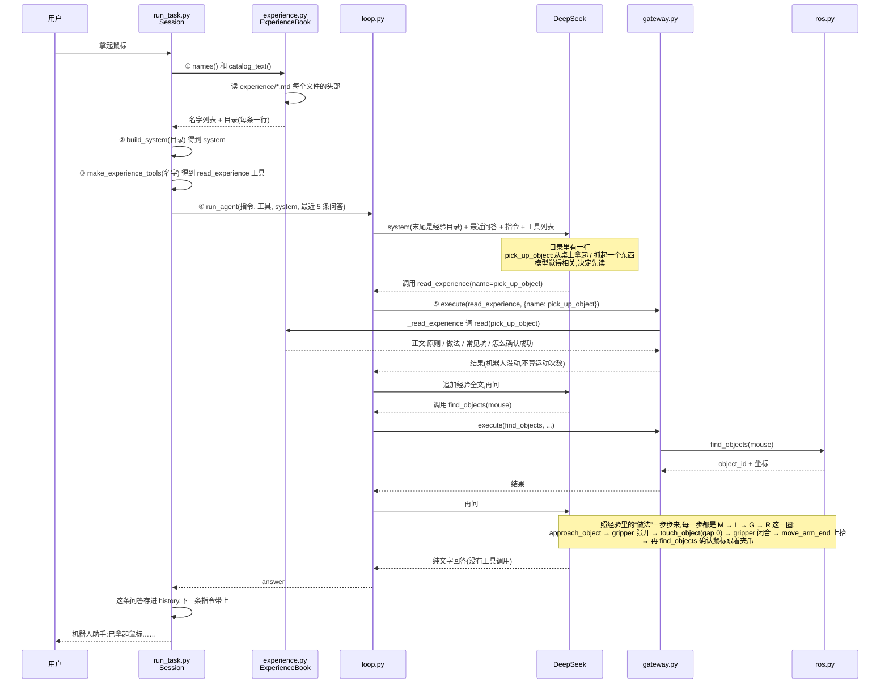

# experience/：给大模型看的经验

SYSTEM 里只放一份目录（每条经验的名字加一句话说明什么时候用）。大模型觉得相关时，调用 `read_experience(name)` 读全文；不相关就不读，不占上下文。

经验是**推荐做法**，大模型可以变通。违反了就危险的规则不放这里，放在程序（gateway）里强制执行。设计原因和效果对比见 [docs/experience.md](../docs/experience.md)。

## 代码怎么串起来（按执行顺序，点链接跳到代码）

### 一条指令里经验是怎么用上的

以“拿起鼠标”为例。模型**不一定**读经验，下面画的是读了的情况；不读的话，第 ⑤ 步那一圈没有，直接从 find_objects 开始。



和 [docs/harness_guide.md](../docs/harness_guide.md) 那张图比，多了三处：

- **开头多了 `Session` 和 `ExperienceBook`**：每条指令开始前，把经验目录拼进 system、把 `read_experience` 加进工具列表（①②③）。
- **多了读经验的那一圈**（⑤）：和别的工具走的路一样（模型 → loop → gateway），只是 gateway 不找 ros.py，而是找 `ExperienceBook` 读文件。
- **结尾多了 history**：这条问答存下来，下一条指令（比如“放到我手上”）带上。

| 步骤 | 做什么 | 代码 |
|---|---|---|
| ① | 交互模式只建一次 `ExperienceBook`，指向本目录 | [run_task.py:77](../scripts/run_task.py#L77) |
| ① | 列出本目录的 `*.md`（不含 README），读每个文件的头部 | [ExperienceBook.entries](../harness/experience.py#L32)、头部解析 [parse](../harness/experience.py#L16) |
| ② | 每条一行：`- 名字:什么时候用` | [catalog_text](../harness/experience.py#L51) |
| ② | 固定部分 + `# 经验目录` | [SYSTEM_BASE](../harness/loop.py#L4)、[build_system](../harness/loop.py#L28)；每条指令都重新生成（[run_task.py:88](../scripts/run_task.py#L88)），审核通过的经验下一条指令就能用 |
| ③ | `read_experience` 的 `name` 参数只能填目录里的名字；另外给 `propose_experience` | [make_experience_tools](../harness/tools/experience.py#L11)，拼进工具列表：[run_task.py:87](../scripts/run_task.py#L87) |
| ④ | 系统提示、最近 5 条问答、本条指令拼成对话 | [run_agent](../harness/loop.py#L38)（history 在 [第 47 行](../harness/loop.py#L47)），条数 [HISTORY_COMMANDS](../scripts/run_task.py#L60) |
| ④ | 模型回复里有工具调用 → 交给 gateway | [loop.py:64](../harness/loop.py#L64) → [_execute](../harness/loop.py#L73) → [Gateway.execute](../harness/gateway.py#L109) |
| ⑤ | 工具名 → 处理函数的表 | [gateway.py:122](../harness/gateway.py#L122) |
| ⑤ | 读全文（去掉头部，只返回正文 + when + status） | [Gateway._read_experience](../harness/gateway.py#L362) → [ExperienceBook.read](../harness/experience.py#L58) |

`read_experience` 不算运动次数，也不会让机器人动。

### 大模型提议新经验 → 人审核 → 生效

```text
模型调用 propose_experience(name, when, content)
  → Gateway._propose_experience → ExperienceBook.propose:检查名字 / 内容 → 写进 experience/pending/<名字>.md
人:python3 scripts/experience.py list / show / approve / reject
  approve:pending/ → experience/(同名旧文件先存成 .md.bak)
下一条指令:Session.run 重新生成目录 → 新经验出现在 SYSTEM 里
```

| 步骤 | 代码 |
|---|---|
| gateway 处理 | [Gateway._propose_experience](../harness/gateway.py#L368) |
| 检查名字格式 [NAME_PATTERN](../harness/experience.py#L13)、写进 `pending/` | [ExperienceBook.propose](../harness/experience.py#L66) |
| 审核命令 | [scripts/experience.py](../scripts/experience.py#L18)：`list`（[第 25 行](../scripts/experience.py#L25)）、`show`（[第 42 行](../scripts/experience.py#L42)）、`reject`（[第 52 行](../scripts/experience.py#L52)）、`approve` 改状态并移过来（[第 60 行](../scripts/experience.py#L60)） |

`experience/pending/` 和 `*.md.bak` 已 gitignore。

### 跟经验一起加的：跨指令状态

| 东西 | 代码 |
|---|---|
| `Session`：交互模式多条指令共用一个 Gateway，每条开始时运动次数清零 | [run_task.py:63](../scripts/run_task.py#L63) |
| `holding`：按夹爪动作推测手里拿着什么 | 初始化 [gateway.py:105](../harness/gateway.py#L105)，推测规则 [_update_holding](../harness/gateway.py#L349)，报给模型 [gateway.py:396](../harness/gateway.py#L396) |

### 测试和场景对比

| 文件 | 测什么 |
|---|---|
| [tests/test_experience.py](../tests/test_experience.py#L26) | 目录、读全文、提议进 pending、gateway 不算运动、SYSTEM 拼接、**本目录每个真经验文件的格式和里面提到的工具都存在**（[第 79 行](../tests/test_experience.py#L79)）、holding |
| [tests/test_session.py](../tests/test_session.py#L41) | 第二条指令能看到第一条的问答和 holding |
| [scripts/run_scenarios.py](../scripts/run_scenarios.py#L118) | 真大模型 + 假机器人，对比“旧 SYSTEM / 新 SYSTEM 无经验 / 新 SYSTEM + 经验”（[第 120~129 行](../scripts/run_scenarios.py#L120)），场景在 [scenarios/](../scenarios/README.md) |

## 一条经验的格式

一个 markdown 文件，文件名就是名字：

```markdown
---
name: pick_up_object              # 和文件名一致,只用小写字母、数字、下划线
when: 从桌上拿起 / 抓起一个东西     # 一句话:什么时候用(会出现在 SYSTEM 的目录里)
status: 真机成功 1 次              # 真机成功 N 次 / 未在真机验证 / 已知有问题
source: traces/20261114_032417.jsonl   # 从哪次 trace 总结出来的,可以写多个
---
## 原则       为什么这样做(写原则,模型才能迁移到没见过的任务)
## 做法       步骤,写清楚用哪个工具、哪些参数
## 常见坑     踩过的坑,附出处
## 怎么确认成功
```

## 经验从哪里来

| 来源 | 去处 |
|---|---|
| 人复盘真机 trace 后写 | 直接放进本目录 |
| 大模型在任务里调用 `propose_experience` | `experience/pending/`，**不生效**，人看过后用 `scripts/experience.py approve <名字>` 移进本目录 |

大模型的自我总结可能是错的（2026-11-14 它确信“已经放到您手上了”，其实没有），所以必须人审。

```bash
python3 scripts/experience.py list              # 正式的和待审的
python3 scripts/experience.py show <名字>
python3 scripts/experience.py approve <名字>    # pending/ → 正式
python3 scripts/experience.py reject <名字>     # 删掉待审的
```
