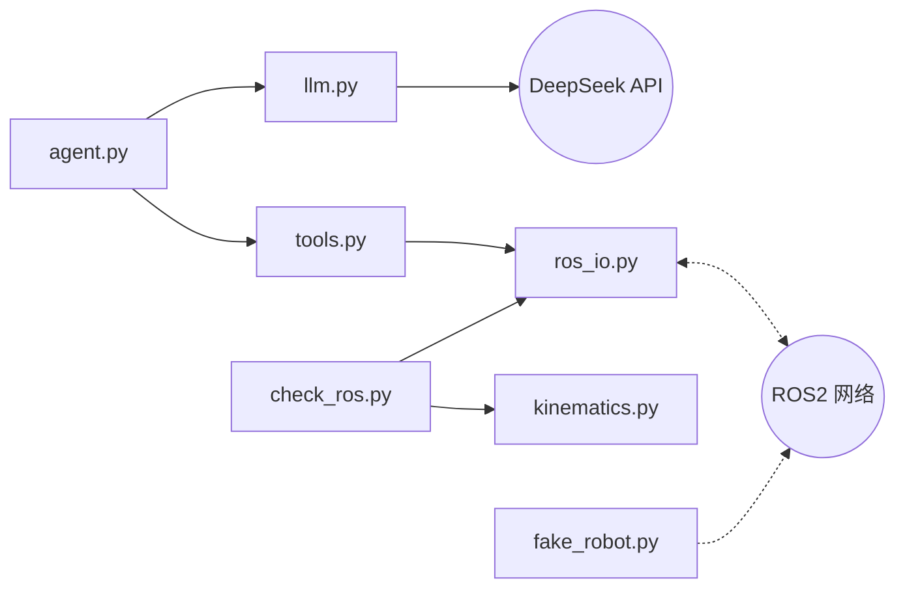
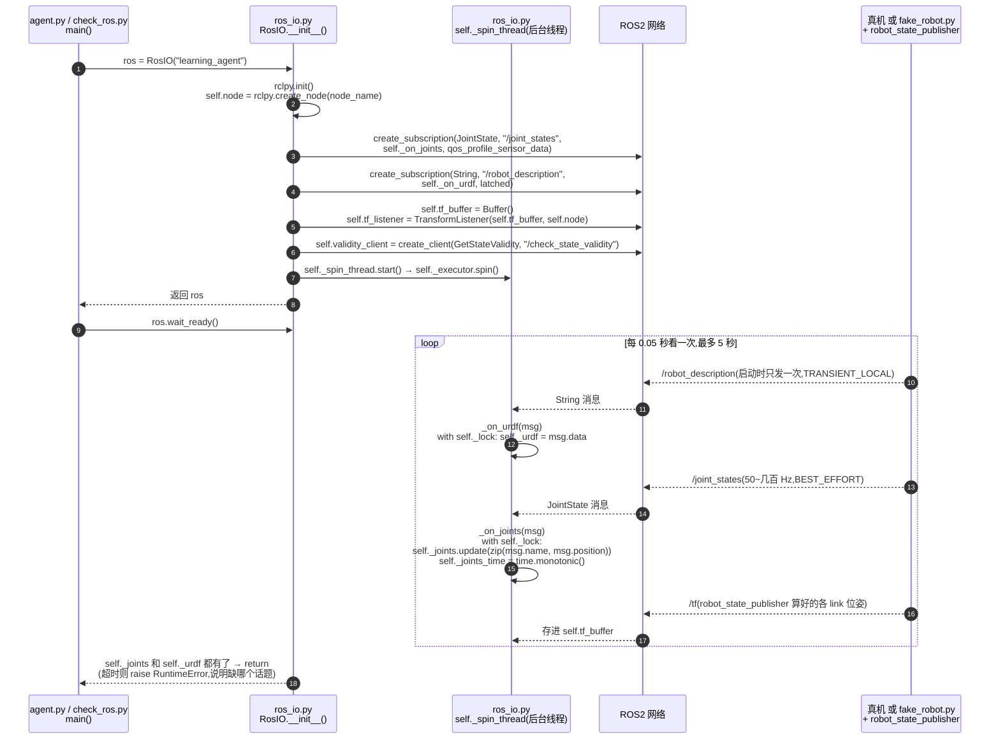
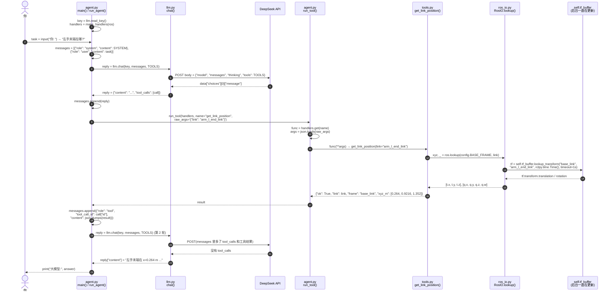
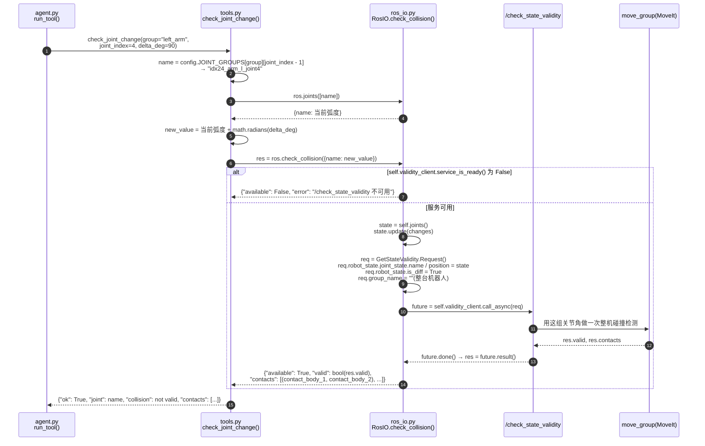
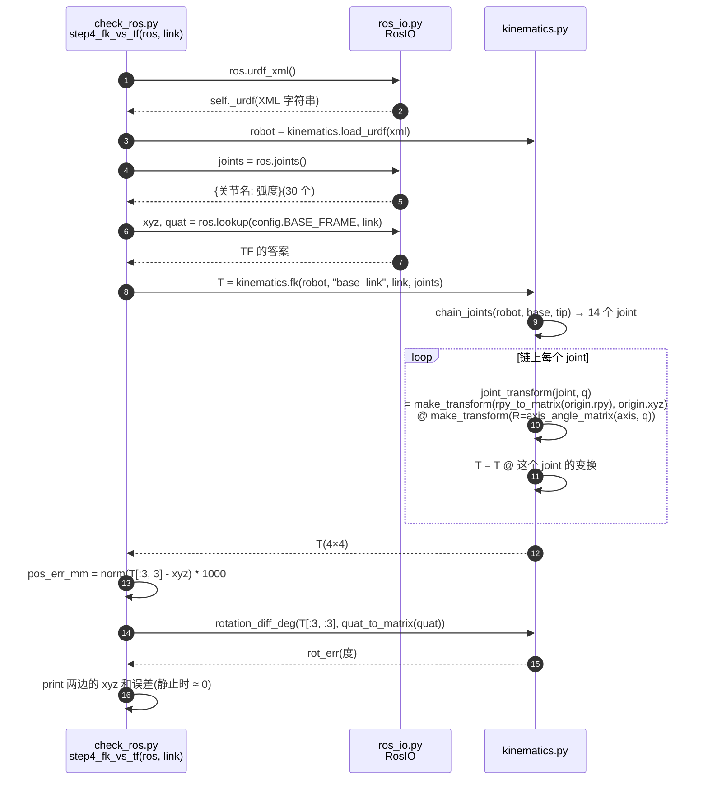
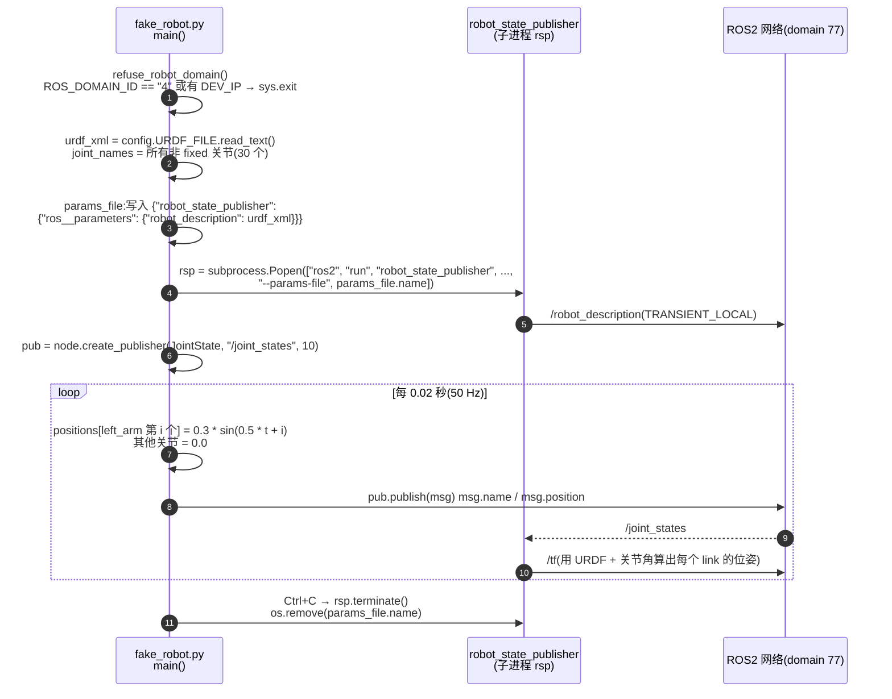

# 第二阶段:打通 ROS2

第一阶段的工具返回的是假数据。这一阶段让程序读到机器人的**真实状态**,再把它接回大模型。

**全部只读**:只订阅话题、查 TF、问 MoveIt“会不会撞”,不发任何控制指令,机器人不会动。让机器人动是第三阶段的内容。

## 能做什么

```text
你:左手末端现在在哪?
  [第0步] get_link_position({"link": "arm_l_end_link"}) -> {'xyz_m': [0.264, 0.9216, 1.352]}
大模型:左手末端在 base_link 下 x=0.264 m、y=0.922 m、z=1.352 m
```

## 文件和阅读顺序

按这个顺序读,每个文件只做一件事:

| 顺序 | 文件 | 做什么 | 需要 ROS 在跑吗 |
|---|---|---|---|
| 1 | `config.py` | 所有话题名、link 名、关节名、超时 | 否 |
| 2 | `ros_io.py` | **唯一碰 rclpy 的文件**:订阅关节和 URDF、查 TF、调 MoveIt | 是 |
| 3 | `kinematics.py` | 自己写的正运动学(FK),纯 numpy | 否 |
| 4 | `check_ros.py` | 5 步演示,把上面的东西逐个打印出来 | 是 |
| 5 | `tools.py` | 给大模型的 3 个只读工具 | 是 |
| 6 | `llm.py` + `agent.py` | 和第一阶段一样的循环,工具换成真的 | 是 |
| — | `fake_robot.py` | 没有真机时,发出和真机一样的话题 | — |

## 文件之间的关系

### 总览



### 时序图

参与者的名字写成“文件名 / 函数或对象”，箭头上写的是**实际的函数调用和变量名**，和代码里一致。实线箭头表示调用，虚线箭头表示返回值或 ROS 消息。

#### ① 启动:`RosIO()` 建立连接,后台线程一直收数据



后台线程一直在跑：`self._joints`、`self._urdf`、`self.tf_buffer` 始终是最新的，主线程随时读。

#### ② 一次问答:`agent.py` 问“左手末端在哪”



#### ③ 碰撞检查:`check_joint_change` 问 MoveIt“肘再弯 90° 会不会撞”



只是“假设”，`req` 里的关节角只发给 MoveIt 算，机器人不会动。

#### ④ `check_ros.py` 第 4 步:自己算 FK,和 TF 对比



#### ⑤ 假机器人:`fake_robot.py` 发出和真机一样的数据



看图时注意两点:

- **只有 `ros_io.py` 连到 ROS 网络。** 其他文件都通过它读数据。
- **TF 不是机器人直接发的。** `robot_state_publisher` 拿关节角和 URDF 算出来再发布。`kinematics.py` 做的是同一件事，所以两边结果一致。

只有 `ros_io.py` 知道 ROS 的存在。以后换成别的机器人,或者 ROS 接口变了,只改这一个文件。

## 运行

### 方式一:没有真机,用假机器人(推荐先用这个)

终端 1:

```bash
source /opt/ros/humble/setup.bash
export ROS_DOMAIN_ID=77          # 和真机(domain 4)隔开
cd ~/robot_harness
python3 learning/stage2_ros/fake_robot.py
```

终端 2(同样的两行环境):

```bash
source /opt/ros/humble/setup.bash
export ROS_DOMAIN_ID=77
cd ~/robot_harness
python3 learning/stage2_ros/check_ros.py
python3 learning/stage2_ros/agent.py
```

`fake_robot.py` 在 domain 4 或者 source 过 `env_g2.sh` 的终端里会拒绝运行。否则假的关节角会发到真机网络里,真机的 MoveIt 会把它当成真实数据。

假机器人没有 MoveIt,所以第 5 步会显示“不可用”,这是正常的。

### 方式二:真机

`hardware.launch.py` 由人在另一个终端启动,然后:

```bash
source ~/agi@g2_robot/env_g2.sh
cd ~/robot_harness
python3 learning/stage2_ros/check_ros.py
python3 learning/stage2_ros/agent.py
```

离线自测 FK(什么都不用开):

```bash
source /opt/ros/humble/setup.bash
python3 learning/stage2_ros/kinematics.py
```

## 这一阶段的 5 个关键概念

1. **订阅和回调**:`create_subscription(类型, 话题, 回调函数, QoS)`。每来一条消息,ROS 就调用一次回调。
2. **spin**:不 spin 就收不到任何消息。`RosIO` 在后台线程里一直 spin,主线程随时读最新数据。因为两个线程同时访问数据,所以要加锁。
3. **QoS 要和发布方匹配**:`/joint_states` 是 BEST_EFFORT,要用 `qos_profile_sensor_data`;`/robot_description` 只发一次,要用 `TRANSIENT_LOCAL`。不匹配不会报错,只是一条都收不到。
4. **TF 是怎么来的**:`robot_state_publisher` 用 URDF 和关节角做 FK,算出每个 link 的位置发到 `/tf`。`check_ros.py` 第 4 步自己算一遍,和 TF 对比,静止时差 0 mm。
5. **读 TF 不需要 MoveIt**:MoveIt 负责碰撞检查和规划。这里只用了它的碰撞检查服务,而且只是“假设这样转会不会撞”,机器人不动。

## 练习

1. `check_ros.py --link head_link3`:头在哪?
2. 在 `config.LINKS_FOR_LLM` 里加一个 link(比如 `arm_l_link2`),再问大模型它在哪。
3. 在 `fake_robot.py` 里让右臂也摆起来,看 `check_ros.py` 第 4 步的误差会不会变大,想一想为什么。
4. 给 `tools.py` 加一个工具 `get_distance(link_a, link_b)`:两个 link 之间的直线距离。现在大模型是自己心算的。
5. 真机上:先 `check_ros.py --step 5`,再问大模型“右臂第 2 关节再转 60 度会撞吗”,和第 5 步的结果对照。
